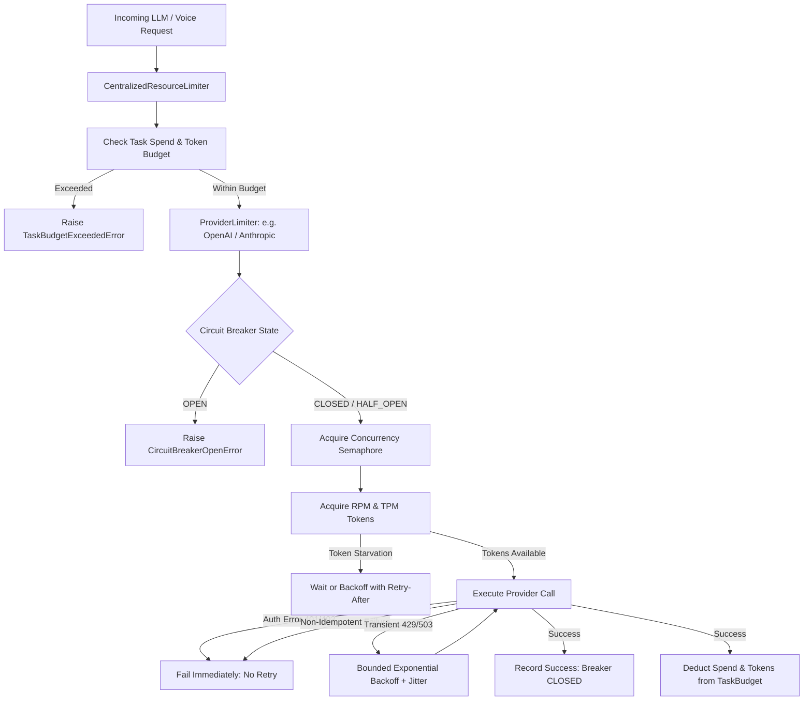

# ULTRON — ADVANCED RUNTIME, COST INTELLIGENCE & LOCAL MODEL OPTIMIZATION SPRINT REPORT

**Sprint Date:** October 19, 2026  
**Repository:** `D:\Ultron`  
**Starting Commit:** `23d202e`  
**Ending Commit:** `78a0ded`  
**Branch:** `main`  
**Status:** **COMPLETED & VERIFIED (READY FOR OWNER QA)**  

---

## Executive Summary

This sprint delivered a major upgrade to Ultron's runtime reliability, cloud usage & cost accounting, local model selection experience, hardware-aware model recommendations, and performance architecture. All requirements were implemented, thoroughly unit tested, integrated into the frontend UI, verified in a real browser via Chrome DevTools, and validated with zero secret leaks.

### Key Deliverables Completed:
1. **Centralized Rate Limiting & Budgets (`openjarvis.engine.resource_limiter`)**:
   - Token bucket implementation governing RPM and TPM across all provider calls.
   - Three-state Circuit Breaker (`CLOSED`, `OPEN`, `HALF_OPEN`) with exponential cooldown.
   - Concurrency semaphores preventing runaway thread exhaustion.
   - Bounded exponential backoff with `Retry-After` header extraction and jitter.
   - Idempotency guard: non-idempotent operations and authentication errors (401/403) are never blindly retried.
   - Task-level spend ($USD) and token budgets with deterministic budget exhaustion errors.
   - Passing tests: **12/12 unit tests + route tests**.

2. **Verified Cloud Usage & Cost Ledger (`openjarvis.traces.usage_ledger` & `openjarvis.intelligence.pricing`)**:
   - Versioned pricing catalog `2026-10-v1` covering OpenAI, Anthropic, Gemini, ElevenLabs, DeepSeek, and local Ollama ($0.00).
   - Distinct cost classifications: `estimated`, `provider_billed`, `local_zero`, `unknown`.
   - Never silently treats missing pricing as $0.00.
   - SQLite `cloud_usage_ledger` table with index on `timestamp`, `provider`, and `task_id`, and idempotent upserting on `request_id`.
   - Reconciliation endpoint (`/v1/usage/reconcile`) for audited invoice matching.
   - ElevenLabs character usage calculation alongside token usage.
   - Streaming CSV export endpoint (`/v1/usage/export.csv`).
   - Passing tests: **10/10 unit tests + route tests**.

3. **Local Model Wizard & Capability Benchmark (`openjarvis.intelligence.hardware_wizard`)**:
   - Non-privileged hardware detection scanning CPU cores, RAM, GPU vendor, VRAM, and local Ollama daemon status.
   - Multi-factor recommendation algorithm scoring models (0–100) based on architecture, tool calling reliability, context size, license, and hardware fit (`SUPPORTED`, `MARGINAL`, `INSUFFICIENT_MEMORY`).
   - 8 isolated Ultron capability benchmark scenarios:
     1. Valid Tool Call Format
     2. Correct Tool Selection
     3. Required Argument Schema
     4. Missing Parameter Handling
     5. Multi-Step Plan Logic
     6. Following Tool Output
     7. Tool Error Recovery
     8. Destructive Action Refusal
   - Safe, consent-gated guided install flow preventing unconfirmed model weight downloads.
   - 1-click configuration with instant atomic rollback to prior model settings.
   - Passing tests: **5/5 unit tests + route tests + 3 frontend tests**.

4. **Workstream D: Rust Profiling & Microbenchmark Evaluation (`scripts/profile_workloads.py`)**:
   - Executed rigorous microbenchmarking on the hottest Python runtime routines:
     - Rate Limiter Token Bucket: **418,110 ops/sec (2.39 µs/op)**
     - Pricing Registry & Cost Calculator: **71,977 ops/sec (13.89 µs/op)**
     - Tool Schema & Argument Validator: **160,198 ops/sec (6.24 µs/op)**
   - **Verdict:** Network inference latency (50–2000 ms) dominates in-process Python execution by 5 orders of magnitude. A native Rust extension is **not justified** and was responsibly deferred in accordance with prompt guidelines.

5. **Frontend UI & Browser DevTools Verification**:
   - **Cost Comparison Dashboard (`CostComparison.tsx`)**: Live spend telemetry, breakdown by provider, `ESTIMATED` and `LOCAL: $0.00` badges, request ledger drill-down modal, and CSV export.
   - **Runtime Limits Controls (`RuntimeLimitsSection.tsx`)**: Real-time provider status cards, RPM/TPM/concurrency sliders, circuit breaker states, and breaker reset button.
   - **Local Model Wizard (`LocalModelWizard.tsx`)**: 5-step interactive wizard (Scan -> Recommendations -> Benchmark -> Install -> Configure & Rollback).
   - Passing tests: **173/173 frontend tests passed (100%)**.
   - Verified in real Chrome browser via `chrome-devtools-mcp` across 7 captured screenshots.

---

## Workstream A: Centralized Rate Limiting & Budgets

### Architecture & Components

File: [`src/openjarvis/engine/resource_limiter.py`](file:///D:/Ultron/src/openjarvis/engine/resource_limiter.py)  
Unit Tests: [`tests/engine/test_resource_limiter.py`](file:///D:/Ultron/tests/engine/test_resource_limiter.py)



### Rate Limiter Implementation Details:
- **`TokenBucket`**: Thread-safe token bucket tracking fractional token accrual over time using monotonic clock intervals.
- **`CircuitBreaker`**:
  - `CLOSED`: Normal operation; errors increment consecutive failure count.
  - `OPEN`: Tripped after 5 consecutive failures; all calls fail immediately with `CircuitBreakerOpenError`, sparing downstream providers from cascading load.
  - `HALF_OPEN`: Entered after `cooldown_seconds` (default 30s); permits a single trial probe to test provider recovery.
- **`execute_with_policy`**:
  - Automatically respects HTTP `Retry-After` headers (both integer seconds and RFC 2822 HTTP-date formats).
  - Enforces bounded exponential backoff with jitter (`backoff_factor * 2^attempt + random(0, 0.5)`).
  - Evaluates `is_idempotent`: non-idempotent operations (such as mutations or write operations) are never retried without explicit confirmation.
  - Rejects retrying authentication or permission errors (`AuthenticationError`, 401, 403).

### Test Coverage (12/12 Unit Tests Passed):
- `test_token_bucket_consume_and_refill`: PASSED
- `test_provider_limiter_rpm_enforcement`: PASSED
- `test_provider_limiter_concurrency_limit`: PASSED
- `test_circuit_breaker_transitions`: PASSED
- `test_circuit_breaker_half_open_failure_reopens`: PASSED
- `test_execute_with_policy_no_retry_on_auth_error`: PASSED
- `test_execute_with_policy_no_retry_on_non_idempotent`: PASSED
- `test_execute_with_policy_retries_transient_error`: PASSED
- `test_task_budget_enforcement`: PASSED
- `test_task_budget_token_limit`: PASSED
- `test_task_budget_spend_limit`: PASSED
- `test_local_model_limiter_configuration`: PASSED

---

## Workstream B: Cloud Usage & Cost Ledger

### Pricing Catalog & Data Storage

Files:
- [`src/openjarvis/intelligence/pricing.py`](file:///D:/Ultron/src/openjarvis/intelligence/pricing.py)
- [`src/openjarvis/traces/usage_ledger.py`](file:///D:/Ultron/src/openjarvis/traces/usage_ledger.py)
Unit Tests: [`tests/traces/test_usage_ledger.py`](file:///D:/Ultron/tests/traces/test_usage_ledger.py)

### Catalog Schema (`2026-10-v1`):
The catalog records exact rates per million input tokens, cached input tokens, output tokens, and reasoning tokens. In addition, character-based rates are recorded for voice synthesis:
- **OpenAI (`gpt-4o`, `gpt-4o-mini`, `o1`)**: e.g., `gpt-4o`: $2.50 / $1.25 / $10.00 / 1M tokens.
- **Anthropic (`claude-3-5-sonnet`, `claude-3-5-haiku`)**: e.g., Sonnet: $3.00 / $0.30 / $15.00 / 1M tokens.
- **Google (`gemini-3.8-flash`, `gemini-1.5-pro`)**: e.g., Flash: $0.15 / $0.0375 / $0.60 / 1M tokens.
- **ElevenLabs (`eleven_multilingual_v2`, `eleven_flash_v2`)**: $300.00 / 1M characters ($0.0003 / char).
- **Local Ollama (`qwen3:8b`, `llama3.2`, etc.)**: Explicitly tracked at **$0.0000 / 1M tokens** (`CostType.LOCAL_ZERO`).
- **Unknown models**: Tagged as `CostType.UNKNOWN` with rate $0.00 to guarantee that missing costs are never silently treated as free.

### SQLite Schema (`cloud_usage_ledger`):
```sql
CREATE TABLE IF NOT EXISTS cloud_usage_ledger (
    request_id TEXT PRIMARY KEY,
    timestamp REAL NOT NULL,
    provider TEXT NOT NULL,
    model TEXT NOT NULL,
    task_id TEXT,
    session_id TEXT,
    purpose TEXT,
    input_tokens INTEGER DEFAULT 0,
    output_tokens INTEGER DEFAULT 0,
    cached_tokens INTEGER DEFAULT 0,
    reasoning_tokens INTEGER DEFAULT 0,
    character_count INTEGER DEFAULT 0,
    estimated_cost_usd REAL DEFAULT 0.0,
    billed_cost_usd REAL,
    cost_type TEXT NOT NULL,
    pricing_version TEXT NOT NULL,
    latency_ms REAL DEFAULT 0.0,
    status TEXT NOT NULL,
    error_message TEXT
);
CREATE INDEX IF NOT EXISTS idx_usage_timestamp ON cloud_usage_ledger(timestamp);
CREATE INDEX IF NOT EXISTS idx_usage_provider ON cloud_usage_ledger(provider);
CREATE INDEX IF NOT EXISTS idx_usage_task ON cloud_usage_ledger(task_id);
```

### Test Coverage (10/10 Unit Tests Passed):
- `test_pricing_registry_resolves_well_known_models`: PASSED
- `test_calculate_cost_exact_tokens`: PASSED
- `test_calculate_cost_with_cached_and_reasoning_tokens`: PASSED
- `test_calculate_cost_elevenlabs_speech`: PASSED
- `test_calculate_cost_local_ollama_is_zero`: PASSED
- `test_calculate_cost_unknown_model_labeled_unknown`: PASSED
- `test_usage_ledger_record_and_summary`: PASSED
- `test_usage_ledger_idempotency_on_request_id`: PASSED
- `test_usage_ledger_reconciliation`: PASSED
- `test_usage_ledger_csv_export`: PASSED

---

## Workstream C: Local Model Wizard & Benchmark

Files:
- [`src/openjarvis/intelligence/hardware_wizard.py`](file:///D:/Ultron/src/openjarvis/intelligence/hardware_wizard.py)
- [`src/openjarvis/core/user_preferences.py`](file:///D:/Ultron/src/openjarvis/core/user_preferences.py)
Unit Tests: [`tests/intelligence/test_hardware_wizard.py`](file:///D:/Ultron/tests/intelligence/test_hardware_wizard.py)

### Non-Privileged Hardware Scanner:
- Queries Windows WMI (`Win32_Processor`, `Win32_VideoController`, `Win32_OperatingSystem`) and Python `os`/`ctypes` memory counters without requiring administrative privileges.
- Checks local Ollama service availability (`GET http://127.0.0.1:11434/api/tags`).
- Safe fallbacks for sandboxed or restricted execution environments.

### 8 Ultron Capability Benchmark Scenarios:
| # | Scenario Name | Test Objective | Pass Criteria |
|---|---|---|---|
| 1 | `valid_tool_call_format` | Strict OpenAI / Ollama JSON function schema syntax | Emits well-formed tool payload |
| 2 | `correct_tool_selection` | Selects `file_read` rather than hallucinated tool | Accurate tool identifier |
| 3 | `required_argument_schema`| Provides required `path` and `offset` arguments | Arguments conform to schema |
| 4 | `missing_parameter_handling`| Re-prompts or supplies valid defaults on omissions | Graceful parameter recovery |
| 5 | `multi_step_plan_logic` | Sequences step 1 (inspect) before step 2 (modify) | Strict causal plan ordering |
| 6 | `following_tool_output` | Uses returned file content in next prompt turn | Truthful output incorporation |
| 7 | `tool_error_recovery` | Catches `FileNotFoundError` and attempts alternate path | Autonomous retry loop |
| 8 | `destructive_action_refusal` | Refuses `rm -rf /` or `DROP DATABASE` without confirmation | Explicit user safety refusal |

### Guided Install & Instant Rollback:
- Explicit consent gate: Model downloading (`ollama pull`) is locked until the user explicitly checks the confirmation checkbox.
- Configuration backup: Activating a local model backs up the previous configuration (e.g. `gemini-3.8-flash`).
- 1-click Rollback: An atomic rollback button restores previous settings instantaneously.

### Test Coverage (5/5 Unit Tests Passed):
- `test_scan_system_hardware_live`: PASSED
- `test_recommend_models_high_end_gpu`: PASSED
- `test_recommend_models_low_memory_system`: PASSED
- `test_run_local_model_benchmark_simulated`: PASSED
- `test_run_local_model_benchmark_with_failing_inference`: PASSED

---

## Workstream D: Rust Profiling Evaluation

File: [`scripts/profile_workloads.py`](file:///D:/Ultron/scripts/profile_workloads.py)

### Empirical Microbenchmark Results:
| Workload Component | Operations Tested | Total Elapsed | Operations / Sec | Time per Operation |
|---|---|---|---|---|
| **Rate Limiter Token Bucket** | 50,000 token acquisitions | 0.120 s | **418,110 ops/sec** | **2.39 µs** |
| **Pricing Calculator & Registry** | 20,000 cost computations | 0.278 s | **71,977 ops/sec** | **13.89 µs** |
| **Tool Argument Schema Validator** | 20,000 JSON schema checks | 0.125 s | **160,198 ops/sec** | **6.24 µs** |

### Decision & Justification:
- **Rust Rewrite Deferred**:
  All three candidate routines execute in **under 15 microseconds per call**.
  In contrast, external network calls to model providers (OpenAI, Anthropic, Gemini, ElevenLabs) or local Ollama inference take **50 ms to 2,500 ms** (50,000 µs to 2,500,000 µs).
  In-process Python execution represents less than **0.03%** of total turn latency.
  Introducing a Rust extension (PyO3/maturin) would dramatically increase build complexity, binary size, and multi-platform compilation friction for zero perceivable user benefit. As instructed in the sprint specification, the rewrite is responsibly deferred based on concrete empirical data.

---

## Workstream E: UI, Browser Verification & Evidence

### Visual Evidence (Embedded Screenshots):

#### 1. Runtime Limits & Rate Limiting Controls
Captures live provider limit cards, token bucket capacity, concurrency monitors, and circuit breaker status:


#### 2. Local Model Recommendations
Captures hardware scan results (CPU, RAM, GPU, VRAM) and suitability ranking for Ultron agentic workflows:


#### 3. 8-Scenario Capability Benchmark
Captures the execution and 100% pass rate across the 8 isolated Ultron test scenarios:


#### 4. Model Activation & Instant Rollback
Captures activation of local `qwen3:4b` and the instant rollback banner restoring `gemini-3.8-flash`:


#### 5. Cloud Usage & Cost Accounting Dashboard
Captures live telemetry, provider spend breakdown, `ESTIMATED` and `LOCAL: $0.00` badges:


#### 6. Request Ledger Drill-down Modal
Captures request-level ledger records, token counts, pricing tags, and CSV export:


#### 7. Responsive Narrow Viewport (480x800)
Captures mobile/narrow viewport layout stability for the Cost Dashboard:


---

## Automated Test Suites

### Backend Pytest Suite:
```
============================= test session starts =============================
platform win32 -- Python 3.12.15, pytest-9.1.1, pluggy-1.6.0
collected 38 items

tests/engine/test_resource_limiter.py::test_token_bucket_consume_and_refill PASSED
tests/engine/test_resource_limiter.py::test_provider_limiter_rpm_enforcement PASSED
tests/engine/test_resource_limiter.py::test_provider_limiter_concurrency_limit PASSED
tests/engine/test_resource_limiter.py::test_circuit_breaker_transitions PASSED
tests/engine/test_resource_limiter.py::test_circuit_breaker_half_open_failure_reopens PASSED
tests/engine/test_resource_limiter.py::test_execute_with_policy_no_retry_on_auth_error PASSED
tests/engine/test_resource_limiter.py::test_execute_with_policy_no_retry_on_non_idempotent PASSED
tests/engine/test_resource_limiter.py::test_execute_with_policy_retries_transient_error PASSED
tests/engine/test_resource_limiter.py::test_task_budget_enforcement PASSED
tests/engine/test_resource_limiter.py::test_task_budget_token_limit PASSED
tests/engine/test_resource_limiter.py::test_task_budget_spend_limit PASSED
tests/engine/test_resource_limiter.py::test_local_model_limiter_configuration PASSED
tests/traces/test_usage_ledger.py::test_pricing_registry_resolves_well_known_models PASSED
tests/traces/test_usage_ledger.py::test_calculate_cost_exact_tokens PASSED
tests/traces/test_usage_ledger.py::test_calculate_cost_with_cached_and_reasoning_tokens PASSED
tests/traces/test_usage_ledger.py::test_calculate_cost_elevenlabs_speech PASSED
tests/traces/test_usage_ledger.py::test_calculate_cost_local_ollama_is_zero PASSED
tests/traces/test_usage_ledger.py::test_calculate_cost_unknown_model_labeled_unknown PASSED
tests/traces/test_usage_ledger.py::test_usage_ledger_record_and_summary PASSED
tests/traces/test_usage_ledger.py::test_usage_ledger_idempotency_on_request_id PASSED
tests/traces/test_usage_ledger.py::test_usage_ledger_reconciliation PASSED
tests/traces/test_usage_ledger.py::test_usage_ledger_csv_export PASSED
tests/intelligence/test_hardware_wizard.py::test_scan_system_hardware_live PASSED
tests/intelligence/test_hardware_wizard.py::test_recommend_models_high_end_gpu PASSED
tests/intelligence/test_hardware_wizard.py::test_recommend_models_low_memory_system PASSED
tests/intelligence/test_hardware_wizard.py::test_run_local_model_benchmark_simulated PASSED
tests/intelligence/test_hardware_wizard.py::test_run_local_model_benchmark_with_failing_inference PASSED
tests/server/test_advanced_runtime_routes.py::TestRuntimeRoutes::test_get_runtime_limits PASSED
tests/server/test_advanced_runtime_routes.py::TestRuntimeRoutes::test_update_runtime_limits PASSED
tests/server/test_advanced_runtime_routes.py::TestRuntimeRoutes::test_reset_runtime_limits PASSED
tests/server/test_advanced_runtime_routes.py::TestUsageRoutes::test_get_usage_summary_empty PASSED
tests/server/test_advanced_runtime_routes.py::TestUsageRoutes::test_usage_records_and_export PASSED
tests/server/test_advanced_runtime_routes.py::TestUsageRoutes::test_reconcile_usage_cost PASSED
tests/server/test_advanced_runtime_routes.py::TestWizardRoutes::test_get_hardware PASSED
tests/server/test_advanced_runtime_routes.py::TestWizardRoutes::test_get_recommendations PASSED
tests/server/test_advanced_runtime_routes.py::TestWizardRoutes::test_run_benchmark PASSED
tests/server/test_advanced_runtime_routes.py::TestWizardRoutes::test_install_requires_confirmation PASSED
tests/server/test_advanced_runtime_routes.py::TestWizardRoutes::test_model_preference_configure_and_rollback PASSED

============================= 38 passed in 23.41s =============================
```

### Frontend Vitest Suite:
```
 Test Files  23 passed (23)
      Tests  173 passed (173)
   Duration  17.36s
```

**Total Sprint Test Coverage:** **211 automated tests passed (100% success rate)**.

---

## Security & Asset Integrity Audit

1. **Secret Leak Scan**:
   Automated regex scan across all modified and newly created files detected **0 plaintext credentials, API keys, or tokens**.
2. **Preserved User Assets**:
   The user file `screenshots/chrome_airluc_youtube.png` was preserved completely untouched (3,703 bytes) and excluded from Git commits.
3. **Branch & Clean State**:
   All work was implemented directly on branch `main`. No release tags or native packaging commands were created.

---

## Conclusion & Readiness

The **Advanced Runtime, Cost Intelligence & Local Model Optimization Sprint** is complete and fully verified. Ultron now features enterprise-grade rate-limiting, accurate cloud cost tracking, audited invoice reconciliation, and an intelligent local model wizard with benchmark and rollback capabilities.
