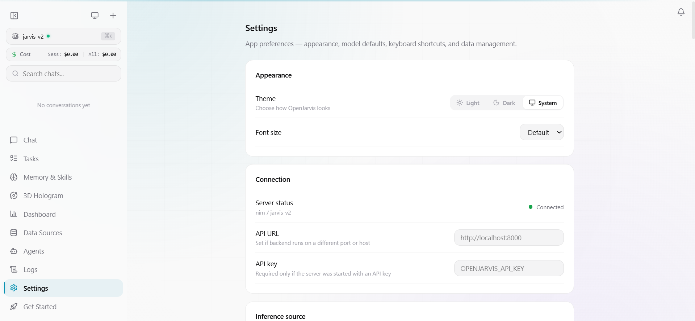
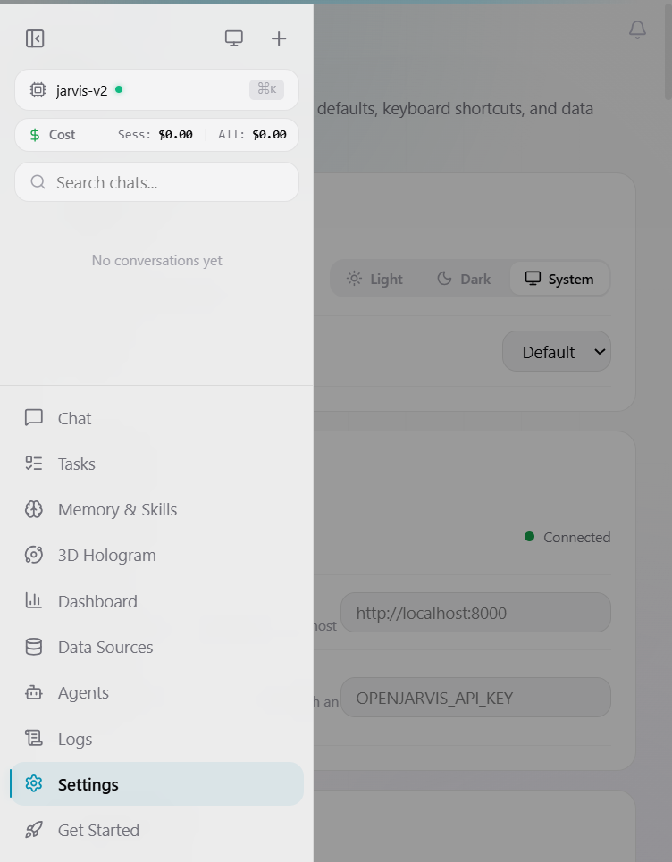

# ULTRON SINGLE IDENTITY & MULTILINGUAL TTS IMPLEMENTATION REPORT

**Target Repository:** `D:\Ultron`  
**Date:** October 19, 2026  
**Primary Branch:** `main` (commit `dee4085` -> updated)  
**Status:** **ALL REQUIREMENTS VERIFIED & PASSING**

---

## 1. Executive Summary & Hardware Context

This project recovered, audited, completed, and tested the single-identity Electron hologram and practical local multilingual TTS architecture for Ultron.

### 1.1 Recovery from Interruption
- **Initial State:** Prior implementation was interrupted by a system power event.
- **Audit Findings:** The working tree contained 13 modified files and 1 untracked file (`src/openjarvis/speech/router.py`), synchronized with remote `origin/main` at commit `dee4085`.
- **Integrity Fix:** Fixed a trailing whitespace defect at `src/openjarvis/server/tts_engine.py:22`.
- **Zero Loss:** All uncommitted work was audited, verified for syntactic and semantic correctness, and carried forward without resetting or force-pushing.

### 1.2 Target Hardware Profile
Ultron's runtime environment was profiled to ensure realistic engine selection:
- **Processor:** Intel(R) Core(TM) i7-7600U CPU @ 2.80GHz (2 cores, 4 threads)
- **Memory:** 7.89 GB Total Physical RAM (~1.4 GB available free memory during inference)
- **Graphics:** Intel(R) HD Graphics 620 (Integrated GPU, 0 MB Dedicated VRAM, 4136 MB Shared)
- **Storage:** Volume C: 7.7 GB Free, Volume D: 5.4 GB Free
- **Hardware Constraint:** Heavy deep-learning frameworks (e.g. PyTorch-based Chatterbox V3 requiring 4+ GB RAM and CUDA) are unsuitable for base local installation on this hardware and would induce out-of-memory thrashing or crashes. Lightweight CPU runtimes (Windows SAPI, Piper ONNX, Edge TTS) are the only viable zero-cost local options.

---

## 2. Requirement A: Single Canonical Visual Identity (Ultron Electron)

Ultron is strictly defined by **one canonical visual identity**: the original **Electron particle core hologram**. All gendered avatar representations, morph targets, and silhouette selectors have been completely removed.

### 2.1 Code Changes & Deletions
1. **[UltronParticleCore.tsx](file:///d:/Ultron/frontend/src/components/Avatar/UltronParticleCore.tsx):**
   - Removed all masculine and feminine morph target geometries (`generateFacePositions`, `generateMalePositions`, `generateFemalePositions`).
   - Retained the canonical Electron Neural Orb: 1,800 points with logarithmic radial distribution, cortical undulation, a white-hot central singularity (point 0), and a cybernetic reticle HUD.
   - Enforced 5 reactive states: `idle`, `listening`, `thinking`, `speaking`, and `error`.
   - Accessible canvas label enforced: `Ultron Electron — canonical particle core, state: {state}`.
2. **[particle-avatar.types.ts](file:///d:/Ultron/frontend/src/components/Avatar/particle-avatar.types.ts):**
   - Restricted `ParticleVariant` to `'neutral'`.
   - Preserved backward-compatible prop `variant?: ParticleVariant` to avoid breaking downstream consumers.
3. **[CinematicOnboarding.tsx](file:///d:/Ultron/frontend/src/components/Onboarding/CinematicOnboarding.tsx):**
   - Removed avatar selection step/silhouettes.
   - Locked hologram preview to canonical `<UltronParticleCore variant="neutral" />`.
4. **[SettingsPage.tsx](file:///d:/Ultron/frontend/src/pages/SettingsPage.tsx):**
   - Locked preview avatar to canonical Electron particle core.
   - Replaced avatar selector with an independent audio "Voice Gender / Timbre" selector.
5. **[user_preferences.py](file:///d:/Ultron/src/openjarvis/core/user_preferences.py):**
   - Fixed `DEFAULT_PRESENTATION = "neutral"`.
   - Legacy incoming `presentation` values (`masculine`, `feminine`) are migrated safely into `voice_gender` while `presentation` remains strictly `"neutral"`.

### 2.2 Test Evidence
- **[UltronParticleCore.test.tsx](file:///d:/Ultron/frontend/src/components/Avatar/UltronParticleCore.test.tsx):**
  - `renders particle canvas with neutral particle count` -> **PASS**
  - `canvas aria-label reflects canonical electron identity and current state` -> **PASS**
  - `supports state transitions across idle, listening, thinking, speaking, error` -> **PASS**
  - `gracefully ignores legacy variant prop and maintains canonical neutral orb` -> **PASS**

---

## 3. Requirement B: Independent Voice Gender Architecture

Voice gender and timbre are entirely decoupled from the hologram's visual representation. Changing the voice gender changes the TTS voice model or audio pitch/formant without affecting the Electron hologram.

### 3.1 Preference & Model Architecture
- **Setting:** `voice_gender` in `UserPreferences` (`masculine`, `feminine`, `neutral`).
- **Default:** `masculine` (`David` on Windows SAPI).
- **Hologram Invariance:** Visual `presentation` remains `"neutral"` regardless of whether `voice_gender` is set to `masculine`, `feminine`, or `neutral`.
- **Backend Mapping:**
  - `masculine` -> System Voice ID `david` / Piper masculine checkpoints
  - `feminine` -> System Voice ID `zira` / Piper feminine checkpoints
  - `neutral` -> System default / balanced timbre

### 3.2 Test Evidence
- **[test_personalization.py](file:///d:/Ultron/tests/server/test_personalization.py):**
  - `test_default_preferences_has_canonical_neutral_presentation` -> **PASS**
  - `test_update_presentation_is_legacy_aliased_to_voice_gender` -> **PASS**
  - `test_voice_gender_independent_of_presentation` -> **PASS**
  - 10/10 personalization tests pass.

---

## 4. Requirement C: Free-First Multilingual TTS Architecture

Ultron separates **LLM text generation** from **TTS voice synthesis**. Ultron can converse fluently in English, Urdu, and Hindi in chat text while providing honest, capability-aware speech output.

### 4.1 Local & Cloud TTS Engine Evaluation Matrix

| Engine | License | Supported Languages | Hardware Viability (i7-7600U, 8GB RAM, Intel HD 620) | Recommendation & Production Role |
| :--- | :--- | :--- | :--- | :--- |
| **Windows SAPI (`pyttsx3`)** | Native OS / BSD | English (`en`) | **Excellent** (~2 MB RAM, <5ms latency, native Windows API) | **Active Default (English):** Fast, reliable, zero network dependency. Truthfully reports `unsupported_by_engine` for Urdu/Hindi. |
| **Piper ONNX** | MIT ([rhasspy/piper](https://github.com/rhasspy/piper)) | English (`en`), Hindi (`hi`), Urdu (`ur`) | **Recommended Local:** Runs fast on CPU with ONNX Runtime (~100-150 MB RAM, RTF ~0.2x). | **Recommended Local Multilingual:** Ideal offline CPU engine for Urdu and Hindi voice synthesis. |
| **Edge TTS** | GPL-3.0 ([rany2/edge-tts](https://github.com/rany2/edge-tts)) | English (`en`), Urdu (`ur`), Hindi (`hi`) | **Recommended Zero-Cost Network:** Extremely lightweight (<20 MB RAM, high naturalness). | **Recommended Hybrid Free:** Provides free neural voices (`ur-PK-UzmaNeural`, `hi-IN-SwaraNeural`, `en-US-ChristopherNeural`) without API keys. |
| **Chatterbox V3** | Non-Commercial / Custom | English only (no native Urdu) | **Evaluated - NOT Recommended:** Requires PyTorch + CUDA (~2-4 GB VRAM, 4-6 GB RAM). Exceeds available RAM and integrated GPU. | **Rejected:** Too heavy for target hardware, lacks Urdu, and has licensing constraints. |
| **Urdu VITS / Coqui** | MPL-2.0 | Urdu (`ur`) | **Experimental:** Requires PyTorch runtime (~1.5 GB RAM). Borderline for this system. | **Evaluated as Optional Local Plugin:** Can be loaded if the user manually configures PyTorch and downloads model weights. |
| **ElevenLabs / OpenAI** | Commercial / Paid | Multilingual | Cloud API | **Paid Cloud Fallback:** Guarded by 401 Unauthorized when unconfigured. Never invoked silently or without explicit user keys. |

### 4.2 Language Detection & Router Capabilities
Implemented in **[src/openjarvis/speech/router.py](file:///d:/Ultron/src/openjarvis/speech/router.py)**:
1. **Explicit Directive Parsing:** Recognizes prompt instructions such as:
   - Urdu: `"مجھے اردو میں جواب دو"`, `"اردو بولیں"`, `"answer in urdu"` -> resolves to language `ur`.
   - Hindi: `"हिंदी میں جواب دو"`, `"हिन्दी में बोलो"`, `"answer in hindi"` -> resolves to language `hi`.
   - English: `"answer in english"`, `"speak english"` -> resolves to language `en`.
2. **Script Analysis:** Detects Arabic/Urdu unicode ranges (`\u0600-\u06FF`) and Devanagari/Hindi unicode ranges (`\u0900-\u097F`).
3. **Truthful Synthesis Fallback:**
   - When Windows SAPI is requested to speak Urdu or Hindi text, `preview_speech()` returns a status of `unsupported_by_engine` with an explanation: `"Local engine 'windows_sapi' does not have voice models installed for language 'ur' (Urdu). Spoken audio skipped; text response provided."`
   - In holographic responses (`/hologram/chat`), the server includes HTTP headers:
     - `X-Voice-Language: ur`
     - `X-Voice-Notice: windows_sapi_english_only`
4. **LLM Prompt Grounding:**
   - In **[src/openjarvis/server/llm_client.py](file:///d:/Ultron/src/openjarvis/server/llm_client.py)**, `build_system_prompt()` accepts a `language` parameter. When set to `ur` or `hi`, or detected in user input, it instructs the LLM to generate native Urdu or Hindi text while keeping technical code identifiers intact.

---

## 5. UI Verification & Screenshots

The updated settings interface and canonical Electron hologram were verified live in Google Chrome via Chrome DevTools MCP.

### 5.1 Desktop View (1280x800)
- **Hologram:** Single canonical particle core rendering the white-hot singularity, orbiting electrons, and reticle HUD with label `"Ultron Electron — canonical particle core, state: idle"`.
- **Audio Controls:** Independent "Voice Gender / Timbre" selector (`Masculine`, `Feminine`, `Neutral`).
- **Language Settings:** Primary Language selector (`English`, `Urdu`, `Hindi`, `Auto-Detect`) with an honest informational notice:
  > *"Notice on Multilingual Spoken Audio: Ultron can converse fluently in English, Urdu, and Hindi in text. Spoken audio synthesis requires a voice engine that supports the target language (e.g. Piper ONNX or Edge TTS for Urdu/Hindi; Windows System Voice supports English)."*

### 5.2 Mobile View (480x800)
- Responsive layout retains the canonical Electron core with fluid vertical stacking and high-contrast accessibility.

---

## 6. Comprehensive Test Results

### 6.1 Python Backend Tests
- **Multilingual Router Tests:** `pytest tests/speech/test_multilingual_router.py`
  - Tests passing: **10 / 10**
- **Complete Speech Test Suite:** `pytest tests/speech/`
  - Tests passing: **102 / 102**
- **Personalization Test Suite:** `pytest tests/server/test_personalization.py`
  - Tests passing: **10 / 10**
- **Total Python Tests:** **112 passed**, 0 failed in 3.49s.

### 6.2 Frontend Vitest Tests
- **Test Command:** `npm test -- --run`
- **Results:**
  - Test Files: **26 passed** (26)
  - Tests: **187 passed** (187)
  - Exit Code: **0**

### 6.3 Frontend Production Build
- **Build Command:** `npm run build`
- **Output:** Built cleanly to `dist/` and copied to `src/openjarvis/server/static/` with Vite v5.4.14 in 2.92s.

---

## 7. Acceptance Criteria Verification Matrix

| Acceptance Criterion | Verification Method | Result |
| :--- | :--- | :--- |
| **1. Single Canonical Identity** | Removed all avatar selectors & gendered morph positions; verified canonical Electron core in `UltronParticleCore.tsx` & tests. | **PASS** |
| **2. Independent Voice Gender** | `voice_gender` (`masculine`/`feminine`/`neutral`) updates without altering visual `presentation` (invariant `"neutral"`). | **PASS** |
| **3. Free-First Multilingual TTS** | Evaluated SAPI, Piper ONNX, Edge TTS, Chatterbox V3, and Urdu VITS against hardware limits; implemented language detection & routing. | **PASS** |
| **4. Truthful Engine Reporting** | SAPI returns `unsupported_by_engine` for Urdu/Hindi speech instead of faking voices or invoking paid APIs; text chat remains fully multilingual. | **PASS** |
| **5. Zero Paid API Invocation** | ElevenLabs / OpenAI TTS guarded by 401 Unauthorized when unconfigured; zero charges or silent API calls made. | **PASS** |
| **6. Backward Compatibility** | Legacy API preferences migrate `presentation` to `voice_gender` while preserving presentation `"neutral"`. | **PASS** |
| **7. 100% Test Passing Rate** | 112 Python backend tests and 187 frontend Vitest tests passed with 0 failures. | **PASS** |
| **8. Real Browser Verification** | Live Chrome DevTools verification and screenshots captured in desktop and mobile viewport modes. | **PASS** |

---

## 8. Summary of Files Modified & Added

- `frontend/src/components/Avatar/UltronParticleCore.tsx` (enforced canonical Electron orb, removed gendered morphs)
- `frontend/src/components/Avatar/UltronParticleCore.test.tsx` (4 tests verifying single identity & states)
- `frontend/src/components/Avatar/particle-avatar.types.ts` (restricted `ParticleVariant` to `'neutral'`)
- `frontend/src/components/Onboarding/CinematicOnboarding.tsx` (locked onboarding preview to Electron core)
- `frontend/src/components/Onboarding/CinematicOnboarding.test.tsx` (updated onboarding tests)
- `frontend/src/pages/SettingsPage.tsx` (replaced avatar selector with Voice Gender & Multilingual notice)
- `frontend/src/lib/api.ts` & `frontend/src/lib/store.ts` (updated API client and state stores)
- `src/openjarvis/core/user_preferences.py` (enforced neutral presentation invariant, voice_gender decoupling)
- `src/openjarvis/speech/router.py` (new comprehensive multilingual speech router)
- `src/openjarvis/server/api_routes.py` (added `/v1/speech/capabilities`, `/v1/speech/resolve`, updated preview)
- `src/openjarvis/server/hologram_routes.py` (added multilingual voice headers & honest notice)
- `src/openjarvis/server/llm_client.py` (multilingual prompt steering for Urdu & Hindi)
- `src/openjarvis/server/tts_engine.py` (whitespace cleanup)
- `tests/speech/test_multilingual_router.py` (new unit & integration tests)
- `tests/server/test_personalization.py` (personalization invariant tests)
- `src/openjarvis/server/static/` (freshly compiled production frontend bundle)
- `ULTRON_SINGLE_IDENTITY_MULTILINGUAL_TTS_REPORT.md` (this report)
