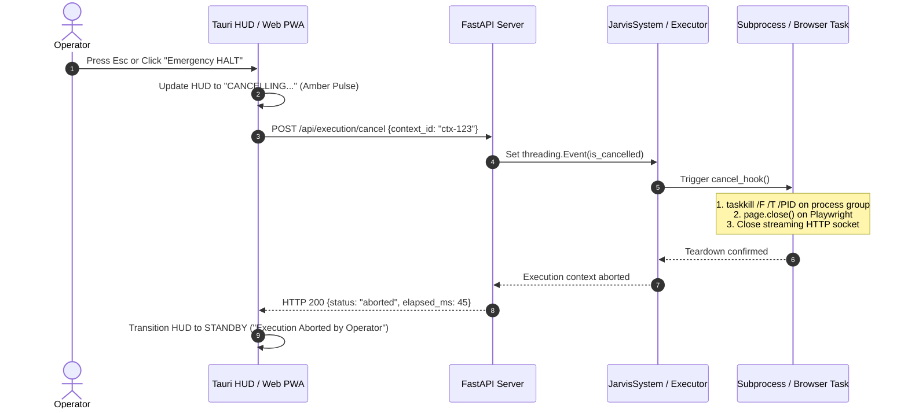
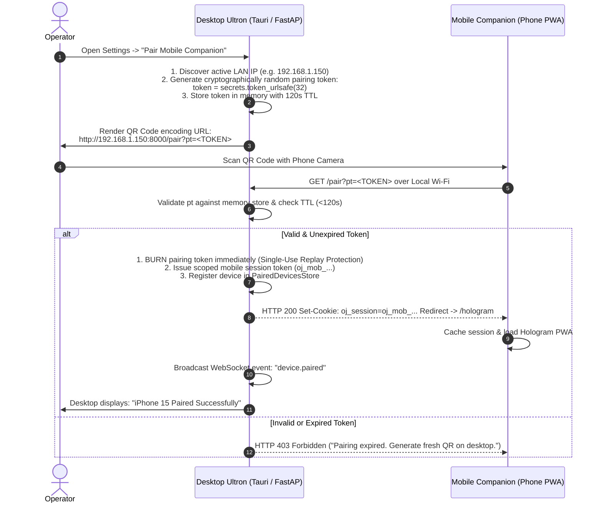
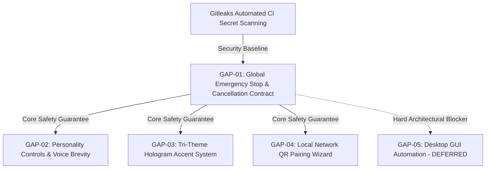

# ULTRON — FEATURE FEASIBILITY & ARCHITECTURE IMPACT ASSESSMENT
**Task Reference:** `TSK-P4-03`  
**Document Status:** Approved Architecture Deliverable  
**Date of Assessment:** October 12, 2026  
**Document Location:** `docs/research/feature-feasibility-architecture-assessment.md`  
**Governing Phase:** Phase 4.3 — External Software Research and Feasibility Assessment  
**Prerequisites:** `TSK-P4-01` ([docs/research/stonic-ai-public-capability-inventory.md](file:///d:/Ultron/docs/research/stonic-ai-public-capability-inventory.md)) & `TSK-P4-02` ([docs/research/stonic-ai-to-ultron-feature-gap-analysis.md](file:///d:/Ultron/docs/research/stonic-ai-to-ultron-feature-gap-analysis.md))  
**Target Backlog Baseline:** Phase 4.4 (`TSK-P4-04`) & Phase 5 Implementation  

---

## 1. EXECUTIVE SUMMARY & RESEARCH SCOPE

### 1.1 Objective & Architectural Mandate
This assessment evaluates the technical feasibility, system-wide architectural impact, and implementation prerequisites for the five candidate capabilities shortlisted in Task `TSK-P4-02`. 

The objective is to establish an unassailable engineering foundation for Phase 5 implementation:
- **Determine what is genuinely worth implementing:** Filter superficial marketing novelties from capabilities delivering concrete safety, reliability, and usability value.
- **Ensure architectural coherence:** Integrate improvements into Ultron's existing FastAPI backend, React/Tauri frontend, and Three.js WebGL Hologram without architectural fragmentation or duplicate rendering engines.
- **Define an end-to-end cancellation contract:** Establish a fail-safe execution control layer that propagates abort signals reliably across network, thread, subprocess, and UI boundaries.
- **Enforce security and privacy boundaries:** Maintain Ultron's zero-exfiltration, local-first privacy commitments. Reject closed cloud relays, artificial commercial paywalls, and unconstrained desktop automation.
- **Preserve governance discipline:** Reaffirm automated CI secret scanning via **Gitleaks** as the governing **P1** security priority.

### 1.2 Evaluation Principles
1. **Safety Precedes Polish:** Robust cancellation and execution safeguards must precede autonomous tool expansion or visual theming.
2. **Local-First Sovereignty:** Features must operate 100% on-premises without mandatory external cloud infrastructure or proprietary subscription dependencies.
3. **Explicit Inference Cost Model:** Distinguish application licensing (Ultron is 100% free under Apache-2.0) from operator inference costs (user-provided cloud API billing or local GPU/CPU hardware resource utilization).

---

## 2. IN-DEPTH ASSESSMENT OF FIVE CANDIDATE IMPROVEMENTS

---

### 2.1 GAP-01: Global Emergency Stop & End-to-End Cancellation Contract

#### A. Problem Analysis & Existing Implementation
When an operator issues a directive resulting in a long-running execution (such as a multi-step subagent loop, a recursive shell command, a hanging browser page load, or a slow LLM stream), Ultron currently lacks an instant physical escape mechanism.
- **Current Shell Execution:** In `src/openjarvis/tools/shell_exec.py` (line 179), `subprocess.run(..., shell=True)` executes synchronously. It blocks the worker thread and has no abort handle.
- **Existing Subprocess Tree Kill Precedent:** In `src/openjarvis/security/subprocess_sandbox.py` (lines 81–92, 143–167), Ultron *already possesses* a robust `kill_process_tree(pid)` function that executes `taskkill /F /T /PID <pid>` on Windows within a dedicated `CREATE_NEW_PROCESS_GROUP`. However, `shell_exec.py` does not currently invoke this abstraction.
- **Subagent Cancellation:** In `src/openjarvis/agents/subagents.py` (lines 376–410), `kill(subagent_id)` invokes `future.cancel()`, but standard Python futures cannot interrupt a thread actively blocked in a synchronous syscall or C-extension socket read.
- **Tauri Native Shortcut Precedent:** In `frontend/src-tauri/Cargo.toml` (line 16), `tauri-plugin-global-shortcut = "2"` is already installed and compiled into the desktop runtime.

#### B. The End-to-End Cancellation Contract
A cosmetic UI button or a simple frontend `keydown` event is **insufficient**. A true cancellation contract requires end-to-end synchronization across five distinct architectural layers:



#### C. Cancellation Protocol Specification
1. **Trigger Layer (Frontend & OS):**
   - *Tauri Desktop:* Register native global hotkey `Ctrl+Alt+Escape` via `tauri-plugin-global-shortcut` and local `Escape` key listener in window focus.
   - *Web / PWA HUD:* Persistent floating `HALT` pill in header bar and `keydown` listener in `index.html`.
2. **Transport Layer (IPC / HTTP):**
   - Immediate dispatch to `POST /api/execution/cancel` with active execution ID.
   - WebSocket broadcast `event: "execution.cancelled"` to all connected clients.
3. **Runtime Coordination Layer (Backend Python):**
   - Every active directive context creates a `CancellationToken` (`threading.Event`).
   - The token is registered in a thread-safe `ActiveExecutionContextStore`.
   - Tool execution loops, agent iterations, and streaming generators check `token.is_set()` before and after every step.
4. **Execution Sandbox Teardown Layer:**
   - *Shell Subprocesses:* Refactor `shell_exec.py` to use `subprocess.Popen` with `CREATE_NEW_PROCESS_GROUP`. On cancellation, execute `kill_process_tree(proc.pid)`.
   - *Browser Automation:* On cancellation, invoke `_session.close()` / `page.close()` with a 500ms timeout to release Chromium resources.
   - *LLM Streaming:* Abort underlying HTTP connection (`httpx.AsyncClient` or `requests` stream) to halt upstream token generation and billing immediately.
5. **Recovery & State Reset:**
   - Teardown must run inside `finally:` blocks.
   - Database transactions rolled back.
   - UI status pill immediately transitions to `standby` with an articulate feedback message: *"Directive aborted cleanly by operator."*

#### D. Feasibility & Strategic Recommendation
- **Feasibility:** **HIGH** (Existing building blocks in `subprocess_sandbox.py` and `tauri-plugin-global-shortcut` eliminate the need for new heavy libraries).
- **Effort:** **MEDIUM**.
- **Decision:** **IMPLEMENT AS PRIORITY 1 (`GAP-01`)**. It is the absolute prerequisite for any subsequent autonomous automation.

---

### 2.2 GAP-02: "Soul Circuit" — Dynamic Personality Controls

#### A. Problem Analysis & Existing Implementation
Ultron's conversational tone is currently governed by a static system prompt template in `src/openjarvis/server/llm_client.py` (`build_system_prompt()`, lines 76–96). While articulate and grounded in authentic JARVIS demeanor, operators cannot calibrate verbosity for fast voice interactions or tune formality to match personal preferences.
- **Existing User Preferences Model:** `src/openjarvis/core/user_preferences.py` persists user address preferences (`user_preferences.json`, lines 15–20) and integrates with multi-user SQLite databases (`users.db`).
- **Prompt Injection Defense:** `src/openjarvis/security/injection_scanner.py` and `tests/server/test_hologram.py` verify that prompt injection attacks are scanned and sanitized prior to execution.

#### B. Architecture Impact & Design Specification
1. **Data Model Extension:**
   Extend `user_preferences.json` with a validated `personality` sub-schema:
   ```json
   {
     "preferred_address": "Sir",
     "personality": {
       "verbosity": 0.5,
       "formality": 0.8,
       "humor": 0.2
     }
   }
   ```
2. **Boundary Validation & Security:**
   - Sliders represent floating-point numbers strictly clamped between `0.0` and `1.0`.
   - Floating-point inputs **cannot carry indirect prompt injections or escape characters**, providing zero attack surface.
   - Default fallback: If fields are missing, each parameter defaults to `0.5` (backward-compatible).
3. **Prompt Composition Protocol:**
   Update `build_system_prompt()` to map numerical float bands into calibrated behavioral directives:
   - *Verbosity (0.0 – 1.0):*
     - `0.0 – 0.3`: *"Ultra-concise executive brevity. Limit answers to 1–2 crisp sentences unless code/technical analysis is explicitly requested."*
     - `0.4 – 0.7`: *"Balanced voice cadence. Provide direct answers with essential context (2–4 sentences)."*
     - `0.8 – 1.0`: *"Exhaustive analytical depth. Provide thorough explanations, background rationale, and detailed breakdown."*
   - *Formality (0.0 – 1.0):*
     - `0.0 – 0.3`: *"Relaxed, conversational banter with casual phrasing."*
     - `0.4 – 0.7`: *"Polite, balanced professional demeanor."*
     - `0.8 – 1.0`: *"Strict executive formality, flawless decorum, and high protocol."*
   - *Humor (0.0 – 1.0):*
     - `0.0 – 0.3`: *"Zero humor. Strictly factual, dry, and analytical."*
     - `0.4 – 0.7`: *"Occasional subtle, dry wit when natural."*
     - `0.8 – 1.0`: *"High wit, razor-sharp banter, and playful composure."*
4. **UI Integration:**
   Expose 3 accessible range inputs with clear tick marks in `SettingsPage.tsx` and the Hologram settings drawer.

#### C. Feasibility & Strategic Recommendation
- **Feasibility:** **HIGH**.
- **Effort:** **SMALL** (Purely prompt templating and JSON configuration; zero runtime dependencies).
- **Decision:** **IMPLEMENT AS PRIORITY 2 (`GAP-02`)**. High user delight and daily voice utility at negligible engineering risk.

---

### 2.3 GAP-03: Tri-Theme Accent Selector for 3D Hologram HUD

#### A. Problem Analysis & Existing Implementation
Ultron's 3D Hologram (`src/openjarvis/server/static/index.html`) is locked to a cyan/gold/emerald palette. Stonic AI popularized three distinct aesthetic skins (Crimson Red, Emerald Green, Cyan Blue).
- **Existing Three.js Infrastructure:** `index.html` loads local `three.min.js`, sets up a WebGL scene, particle orbital loops, concentric reticle rings, and CSS root tokens (`--accent-cyan`, `--accent-amber`, `--accent-emerald`).
- **Rendering Architecture:** Three.js materials in `index.html` use direct hex colors (`0x00f3ff`, line 1427).

#### B. Architectural Solution: Unified Palette Injection
To avoid rendering duplication or multiple WebGL canvas contexts, themes should be implemented as a lightweight **Uniform and CSS Property Controller**:

```javascript
const HOLOGRAM_THEMES = {
  cyan: {
    name: 'Cyan Mark I (Classic Ultron)',
    cssAccent: '#38bdf8',
    cssDim: 'rgba(56, 189, 248, 0.18)',
    threeStandby: 0x00f3ff,
    threeCore: 0x38bdf8
  },
  crimson: {
    name: 'Crimson Mark II (Iron Man Armor)',
    cssAccent: '#ef4444',
    cssDim: 'rgba(239, 68, 68, 0.18)',
    threeStandby: 0xff2a4b,
    threeCore: 0xef4444
  },
  emerald: {
    name: 'Emerald Mark III (Tactical Matrix)',
    cssAccent: '#10b981',
    cssDim: 'rgba(16, 185, 129, 0.18)',
    threeStandby: 0x00ff88,
    threeCore: 0x10b981
  }
};
```

1. **Accessibility & Contrast:**
   - All theme accents are verified for WCAG AA contrast (minimum 4.5:1 against `#06080e` background).
   - Support `prefers-reduced-motion`: When active, particle rotational speed drops to 0.001 and breathing scale animations are flattened.
2. **Persistence:**
   - Stored in browser `localStorage.getItem('ultron-hologram-theme')`.
   - Instantly applied before initial Three.js render to prevent color flash.
3. **Zero Asset Copying:**
   - Uses Ultron's independent mathematical particle geometry and orbital line loops; zero Stonic assets, textures, or models used.

#### C. Feasibility & Strategic Recommendation
- **Feasibility:** **HIGH**.
- **Effort:** **SMALL**.
- **Decision:** **IMPLEMENT AS PRIORITY 3 (`GAP-03`)**. Zero regression risk, low complexity, high aesthetic polish.

---

### 2.4 GAP-04: Local Network QR Pairing Wizard for Mobile PWA

#### A. Problem Analysis & Existing Implementation
Ultron's standalone PWA manifest (`src/openjarvis/server/static/manifest.webmanifest`) and `/hologram` route are already accessible over the local network. However, pairing a smartphone currently requires manually discovering the host's LAN IP address, typing it into a mobile browser, and manually configuring credentials.
- **Stonic AI Architecture Contrast:** Stonic AI routes mobile commands through central cloud servers (`stonicai.com`). This creates external dependency, requires recurring cloud subscriptions ($19/$49/mo), and exfiltrates desktop control streams.
- **Ultron Security Architecture:** `src/openjarvis/server/auth_middleware.py` protects non-loopback endpoints, while `src/openjarvis/channels/whatsapp_baileys_bridge/` provides precedent for QR-based cryptographic exchange.

#### B. Local-First Zero-Trust Pairing Architecture
Ultron must reject central cloud relay servers and adopt a **local-network cryptographic pairing handshake**:



#### C. Threat Model & Mitigation
- **QR Code Exposure:** The QR code displays a *short-lived (120-second TTL), single-use bootstrap token*, NOT a permanent API key. Even if captured in a photo, it cannot be reused once burned or expired.
- **Network Boundaries & Firewall:**
  - FastAP server binds to LAN interface only when the operator explicitly clicks "Enable Mobile Access" in Settings.
  - Windows Defender Firewall prompt: Installer / launcher handles opening inbound TCP port 8000 for private networks only.
- **Scoped Permissions:**
  - Mobile sessions are granted `Role.MOBILE_OPERATOR` (voice input, directive issuance, system monitoring), but **explicitly denied** destructive admin functions (e.g., database deletion, file wiping, or setting up external webhooks).
- **One-Click Revocation:**
  - The desktop Settings panel displays all active paired devices with a 1-click "Revoke All Paired Devices" button that purges active mobile session hashes instantly.

#### D. Feasibility & Strategic Recommendation
- **Feasibility:** **MEDIUM** (Requires local IP discovery, pairing token route, and dynamic canvas QR generator).
- **Effort:** **MEDIUM**.
- **Decision:** **IMPLEMENT AS PRIORITY 4 (`GAP-04`)**. Delivers true mobile companion freedom while rigorously preserving zero-exfiltration privacy.

---

### 2.5 GAP-05: Native Desktop GUI Automation (Synthetic Mouse & Keyboard)

#### A. Problem Analysis & Existing Implementation
Stonic AI advertises hands-free computer control by taking periodic screen captures, passing them to a vision model, and synthetically clicking/typing into native desktop applications (e.g., Spotify, WhatsApp Desktop).
- **Ultron's Existing Automation Tools:**
  - Web automation: Full Playwright Chromium automation (`src/openjarvis/tools/browser.py`, `browser_axtree.py`) with semantic accessibility targeting.
  - Operating system automation: Sandboxed shell execution (`src/openjarvis/tools/shell_exec.py`, `src/openjarvis/security/subprocess_sandbox.py`) for launching apps, manipulating files, and running system scripts.
  - Social messaging: Native headless WebSocket bridges (`src/openjarvis/channels/whatsapp_baileys.py`) operating invisibly without UI interaction.

#### B. Engineering Risk & Failure Mode Analysis
Synthetic OS-level mouse clicking on Windows presents severe technical, reliability, and security risks:

| Risk Category | Technical Failure Mechanism | Severity & Impact on Ultron |
| :--- | :--- | :---: |
| **DPI & Multi-Monitor Scaling** | Windows displays with 125%, 150%, or 200% DPI scaling cause VLM coordinate predictions to drift by 20–50 pixels, clicking wrong UI elements or empty space. | **HIGH (Reliability Failure)** |
| **UIPI & Privilege Blocks** | Windows User Interface Privilege Isolation (UIPI) strictly blocks synthetic input from standard processes to elevated (Administrator) windows. Tools silently fail without feedback. | **HIGH (Execution Block)** |
| **Focus Stealing & Desync** | Moving the mouse and clicking native windows steals focus from the operator, interrupting active typing and causing race conditions if the user touches the mouse. | **HIGH (User Disruption)** |
| **Destructive Misclicks** | A 30-pixel coordinate error can click "Delete", "Format", or "Discard Changes" instead of "Save". | **CRITICAL (Data Loss Risk)** |
| **Latency & Token Cost** | Every step requires a 4K/1080p screenshot (~1–3 MB), vision token encoding (~1,600 tokens), and VLM roundtrip (2–5 seconds). A 10-step desktop action costs ~20,000 tokens and 40+ seconds. | **MEDIUM (Economic & Latency Burden)** |
| **Dependency on GAP-01** | **Strict Hard Blocker:** Autonomous desktop clicking without a verified global Emergency Stop (`Esc`) can lock the user out of their own mouse and keyboard in an infinite runaway loop. | **CRITICAL (Safety Blocker)** |

#### C. Feasibility & Strategic Recommendation
- **Feasibility:** **LOW** (Due to DPI drift, UIPI elevation barriers, and high vision token latency).
- **Effort:** **LARGE**.
- **Decision:** **DEFER AND RESEARCH FURTHER (`GAP-05`)**. Ultron's combination of Playwright web automation and headless communication channels already solves 90% of real user workflows far more reliably and safely than screen-clicking. GUI automation must **NOT** be attempted before GAP-01 cancellation is fully implemented and battle-tested.

---

## 3. ARCHITECTURE & FEASIBILITY COMPARISON MATRIX

| Evaluation Dimension | GAP-01: Global Emergency Stop | GAP-02: Personality Controls | GAP-03: Hologram Themes | GAP-04: Local QR Pairing | GAP-05: Desktop GUI Automation |
| :--- | :--- | :--- | :--- | :--- | :--- |
| **Exact Source Anchors** | `security/subprocess_sandbox.py`<br>`tools/shell_exec.py`<br>`agents/subagents.py`<br>`src-tauri/Cargo.toml` | `core/user_preferences.py`<br>`server/llm_client.py`<br>`frontend/src/pages/SettingsPage.tsx` | `server/static/index.html`<br>`frontend/src/index.css` | `server/auth_middleware.py`<br>`server/auth_routes.py`<br>`channels/whatsapp_baileys_bridge/` | `tools/browser.py`<br>`tools/shell_exec.py`<br>`security/capabilities.py` |
| **User Value** | Critical safety, runaway loop abort, predictable recovery | High conversational voice utility, personalized conciseness | Visual delight, customization, high aesthetic appeal | Effortless mobile onboarding, zero cloud exfiltration | High theoretical appeal, fragile execution in practice |
| **Technical Feasibility** | **HIGH** | **HIGH** | **HIGH** | **MEDIUM** | **LOW** |
| **External Dependencies** | None (uses native `taskkill` and existing `tauri-plugin-global-shortcut`) | None | None | `qrcode` canvas helper in frontend | `pyautogui` or `pywinauto` + VLM vision model |
| **Security & Privacy Risks** | Race condition between cancel and tool return | Potential prompt injection if unvalidated (mitigated by float clamping) | Accessibility / contrast degradation (mitigated by WCAG tokens) | Unauthorized LAN access (mitigated by 120s TTL & scoped roles) | Destructive misclicks, focus stealing, UIPI privilege blocks |
| **Shared Prerequisites** | Independent baseline | None | None | LAN server binding | **STRICTLY BLOCKED BY GAP-01** |
| **Estimated Effort** | **Medium** | **Small** | **Small** | **Medium** | **Large** |
| **Strategic Decision** | **IMPLEMENT (Rank 1)** | **IMPLEMENT (Rank 2)** | **IMPLEMENT (Rank 3)** | **IMPLEMENT (Rank 4)** | **DEFER / RESEARCH (Rank 5)** |

---

## 4. SHARED DEPENDENCY HIERARCHY & SEQUENCE

The architectural relationships between candidate improvements establish a strict dependency order:



1. **Prerequisite 0 (Security):** Automated CI secret scanning via **Gitleaks** must be integrated to protect repository assets.
2. **Prerequisite 1 (Safety Core):** **GAP-01 (Global Emergency Stop)** must be implemented before any long-running tool or remote companion feature.
3. **Phase 5 Feature Tier:** **GAP-02**, **GAP-03**, and **GAP-04** can proceed safely once GAP-01 is operational.
4. **Deferred Tier:** **GAP-05** is deferred to a future research cycle pending multi-monitor DPI scaling and coordinate validation prototypes.

---

## 5. REQUIRED SECURITY AUDIT: GITLEAKS CI SECRET SCANNING

- **Status in Repository:** **CONFIRMED P1 PRIORITY — UNRESOLVED & UNINSTALLED**.
- **Audit Evidence:** Verification of all 13 workflow files in `.github/workflows/` confirms zero automated secret scanners are currently active.
- **Sequencing Mandate:** Gitleaks automated secret scanning remains the governing top-priority engineering action for repository protection. In strict accordance with scope discipline, it is **not** implemented during this research-only task, but is scheduled as the immediate pre-implementation action prior to Phase 5 feature work.

---

## 6. INFERENCE & LICENSING COST TRANSPARENCY

To prevent developer and user confusion:
- **Application Licensing:** Ultron is **100% free software** distributed under the Apache License 2.0. Ultron will never charge subscription fees, impose seat licenses, or enforce artificial feature paywalls.
- **Model Inference Operating Costs:**
  - *Local Inference:* 100% free of charge via local Ollama, utilizing the operator's local GPU/CPU hardware.
  - *Cloud Inference:* When an operator configures their own API keys (BYOK) for Google Gemini, OpenAI, or Anthropic, any API consumption is billed directly to the user by the respective model provider. Ultron acts purely as a local client and charges zero markups or platform fees.

---

## 7. RECOMMENDATIONS FOR PHASE 4.4 & PHASE 5

1. **Authorize Task `TSK-P4-04` (Independent Implementation Plan):**
   - Synthesize architectural specifications for `GAP-01`, `GAP-02`, `GAP-03`, and `GAP-04` into independent implementation blueprints without proprietary Stonic code or reverse engineering.
2. **Phase 5 Implementation Sequence:**
   - **Step 1:** Implement Gitleaks CI Secret Scanning workflow (`.github/workflows/security-gitleaks.yml`).
   - **Step 2 (`TSK-P5-02`):** Implement End-to-End Emergency Stop & Cancellation Contract (`GAP-01`).
   - **Step 3 (`TSK-P5-07`):** Implement "Soul Circuit" Dynamic Personality Controls (`GAP-02`).
   - **Step 4 (`TSK-P5-08`):** Implement Tri-Theme Hologram HUD Color System (`GAP-03`).
   - **Step 5 (`TSK-P5-09`):** Implement Local Network QR Pairing Wizard (`GAP-04`).
