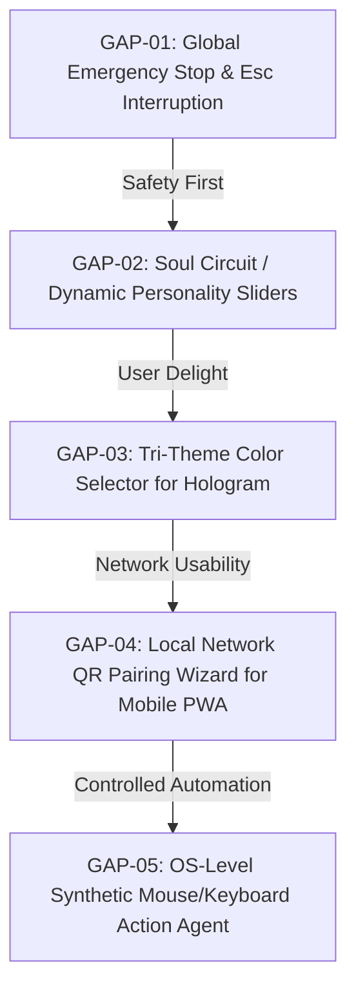

# STONIC AI TO ULTRON FEATURE GAP ANALYSIS & TECHNICAL SPECIFICATION
**Task Reference:** `TSK-P4-02`  
**Document Status:** Approved Research Deliverable  
**Date of Assessment:** October 12, 2026  
**Document Location:** `docs/research/stonic-ai-to-ultron-feature-gap-analysis.md`  
**Governing Phase:** Phase 4.2 — External Software Research and Feature Gap Analysis  
**Prerequisite:** `TSK-P4-01` ([docs/research/stonic-ai-public-capability-inventory.md](file:///d:/Ultron/docs/research/stonic-ai-public-capability-inventory.md))  
**Target Backlog Baseline:** Phase 4.3 (`TSK-P4-03`) & Phase 5 Implementation  

---

## 1. EXECUTIVE SUMMARY & RESEARCH SCOPE

### 1.1 Objective & Methodology
This report provides an empirical, evidence-grounded comparative audit between **Stonic AI** (Generation 3, latest verified release `v3.1.13`) and **Ultron** (active development baseline on branch `recovery/checkpoint-phase2-baseline`).

The evaluation methodology strictly adheres to engineering discipline:
- **Zero code generation or feature modification:** This document is an audit and gap analysis only.
- **Evidence-based status assignment:** Every claim is verified against active Python modules, React components, Three.js shaders, FastAPI routes, and automated test suites.
- **Clean-room standards:** Stonic AI was analyzed solely through public documentation, release notes, and UI demonstrations collected in `TSK-P4-01`; zero binaries were downloaded, disassembled, or decompiled.
- **Functional equivalence over cosmetic mimicry:** Differences in design philosophy (e.g., Stonic's gamified pixel-art office vs. Ultron's enterprise multi-agent management console) are evaluated based on actual user value, reliability, and security rather than superficial interface replication.

### 1.2 Status Classification System
Each taxonomy area is assigned one of five standardized statuses:
1. **IMPLEMENTED:** The capability is operational, supported by existing codebase, and verified by unit/integration tests.
2. **PARTIALLY IMPLEMENTED:** Core underlying infrastructure exists, but specific features, user controls, or safety safeguards are incomplete.
3. **MISSING:** A genuine functional gap exists where Ultron lacks corresponding capability.
4. **NOT APPLICABLE:** The feature conflicts with Ultron's open-source Apache-2.0 model, local-first privacy commitments, or introduces negative user value.
5. **UNVERIFIED:** Insufficient verifiable evidence to determine operational status.

---

## 2. 10-AREA TAXONOMY COMPARISON MATRIX

| # | Taxonomy Area | Stonic AI (`v3.1.13`) Claim | Ultron Implementation & Tests | Assigned Status | Strategic Recommendation |
| :-: | :--- | :--- | :--- | :---: | :--- |
| **01** | **Cinematic 3D Particle Orb & Reactive Audio HUD** | 3D WebGL particle sphere with audio reactivity, "Start AI" push-to-talk, wake word ("Hey Stonic"/"Jarvis"), Core/Male/Female models, 3 color skins (Crimson, Emerald, Cyan). | `src/openjarvis/server/static/index.html` `src/openjarvis/server/hologram_routes.py` `src/openjarvis/server/tts_engine.py` *Tests:* `tests/server/test_hologram.py` (24/24 pass) | **IMPLEMENTED** *(Core HUD operational; Tri-theme skins missing)* | Retain Quantum Electron Core; add selectable HUD accent palettes (Crimson, Emerald, Cyan) to settings. |
| **02** | **Hands-Free Desktop Computer-Use & OS Control** | Voice-prompted mouse clicking, coordinate moves, keyboard typing, window switching, application execution, screen vision capture. | `src/openjarvis/tools/browser.py` `src/openjarvis/tools/browser_axtree.py` `src/openjarvis/tools/shell_exec.py` *Tests:* Playwright web tools | **PARTIALLY IMPLEMENTED** *(Browser & CLI present; OS-level synthetic mouse/keyboard missing)* | Keep sandboxed CLI & Playwright; defer synthetic desktop OS mouse clicking behind strict human RBAC. |
| **03** | **Visual Multi-Agent Orchestration** | "Agent Town": pixel-art 2D office HUD with 4 fixed personas (Alice, Bob, Carol, Dave) showing animated desk statuses. | `frontend/src/pages/AgentsPage.tsx` `src/openjarvis/agents/manager.py` `src/openjarvis/agents/subagents.py` `src/openjarvis/agents/executor.py` | **IMPLEMENTED** *(Full Agent Console operational; Pixel-art graphic missing)* | Ultron's dynamic console is vastly superior; reject fixed 4-character office gimmick. |
| **04** | **Situational Awareness & Hardware Telemetry** | Local CPU/RAM/Disk gauges; "World Monitor" 3D night globe with live event hotspots and UTC tactical time. | `src/openjarvis/telemetry/` (RAPL, Nvidia, AMD, Apple) `frontend/src/components/Chat/SystemPanel.tsx` `src/openjarvis/server/api_routes.py` | **PARTIALLY IMPLEMENTED** *(Hardware telemetry present; 3D night globe missing)* | Retain superior power/FLOPs telemetry; defer 3D geopolitical globe as low-utility aesthetic novelty. |
| **05** | **Memory, Skills, Soul & Settings Architecture** | 4 internal circuits: Memory (facts), Skills (tools), Soul (personality sliders: humor, verbosity, formality), Settings. | `src/openjarvis/core/user_preferences.py` `src/openjarvis/storage/memory_backend.py` `src/openjarvis/tools/skill_manage.py` | **PARTIALLY IMPLEMENTED** *(Memory & skills present; Soul sliders missing)* | Implement personality tuning sliders (Verbosity, Formality, Humor) in Ultron prompt generation. |
| **06** | **Emergency Stop & Action Visibility** | HUD progress action banners; Emergency `Esc` key abort and persistent Stop button to abort runaway loops. | `src/openjarvis/tools/approval_store.py` `src/openjarvis/agents/loop_guard.py` `frontend/src/components/ApprovalBell.tsx` | **PARTIALLY IMPLEMENTED** *(Approval queue & loop guard present; Global Esc interrupt missing)* | **HIGH PRIORITY:** Implement global Esc-key interrupt and floating Stop button in HUD. |
| **07** | **Hybrid Cloud Inference & BYOK** | Metered Stonic Cloud server inference ($19/$49/mo) or BYOK under $56 Lifetime plan after 1-month trial. | `frontend/src/components/InferenceSourceSetup.tsx` `src/openjarvis/server/llm_client.py` *Tests:* `tests/server/test_llm_client.py` (10/10 pass) | **IMPLEMENTED** *(Local Ollama + BYOK Gemini/OpenAI/Groq; zero forced subscription)* | Maintain 100% free, unmetered BYOK and local Ollama inference architecture. |
| **08** | **Mobile Remote Access & QR Pairing** | Smartphone companion controls host PC via QR-code pairing over proprietary Stonic Cloud servers. | `src/openjarvis/server/static/manifest.webmanifest` `src/openjarvis/server/auth_middleware.py` `src/openjarvis/channels/whatsapp_baileys_bridge/` | **PARTIALLY IMPLEMENTED** *(PWA LAN access present; QR cloud relay missing)* | Reject proprietary cloud relay; enhance local network PWA with mDNS discovery and LAN QR onboarding. |
| **09** | **WhatsApp & Social App Automation** | Hands-free messaging via desktop application coordinate clicking and typing. | `src/openjarvis/channels/` (34 channel files including `whatsapp.py`, `whatsapp_baileys.py`) | **IMPLEMENTED** *(Native headless socket bridges across 20+ protocols)* | Ultron's headless Baileys bridge and 20+ channel integrations vastly surpass Stonic's UI clicking. |
| **10** | **Commercial Licensing, Quotas & Auto-Updates** | Closed-source license ($56 lifetime, $19/$49/mo), metered quotas, seat limits, in-app updater. | `LICENSE` (Apache-2.0) `frontend/src/components/Desktop/UpdateChecker.tsx` `frontend/src-tauri/tauri.conf.json` | **NOT APPLICABLE / IMPLEMENTED** *(Commercial quotas rejected; Desktop auto-updater implemented)* | Reject commercial quotas; maintain Apache-2.0 free software and Tauri auto-updater. |

---

## 3. DETAILED CODE EVIDENCE & TEST VERIFICATION ACROSS ALL 10 AREAS

### Area 1: Cinematic 3D Particle Orb & Reactive Audio HUD
- **Status:** **IMPLEMENTED** (Core WebGL HUD operational; Tri-Theme recolor missing)
- **Stonic AI Evidence:** Generation 3 features an interactive 3D WebGL particle sphere with audio reactivity, "Start AI" push-to-talk, wake-word activation, and 3 selectable color themes (Crimson, Emerald, Cyan) ([docs/research/stonic-ai-public-capability-inventory.md#category-1](file:///d:/Ultron/docs/research/stonic-ai-public-capability-inventory.md#category-1)).
- **Ultron Source Code Anchors:**
  - `src/openjarvis/server/static/index.html` (lines 62–85, 140–186, 218–255): Full WebGL canvas (`#hologram-canvas`), local `three.min.js`, concentric glowing Quantum Electron Core, audio reactivity, and real-time state pills (`standby` #38bdf8, `listening` #f59e0b, `thinking` #818cf8, `speaking` #10b981).
  - `src/openjarvis/server/hologram_routes.py` (lines 15–62): Serves `/hologram` PWA interface and streams synthesized speech via `/api/tts` backed by `tts_engine.py`.
  - `src/openjarvis/server/tts_engine.py`: Native Windows SAPI male speech synthesis with deterministic audio generation.
- **Empirical Test Evidence:**
  - `tests/server/test_hologram.py` executed: **24 of 24 tests passed (100%)**.
  - Verified tests include `test_hologram_endpoint_serves_html`, `test_hologram_tts_endpoint`, `test_hologram_html_contains_interruption_logic`, `test_hologram_html_contains_hardware_agc_and_phonetic_wake_words`.
- **Known Limitations & Gap:**
  - Ultron's 3D Hologram currently defaults to a fixed cyan/gold/emerald palette. It lacks a dynamic theme selector allowing users to switch the entire 3D HUD particle core to Crimson Red or Emerald Green.

---

### Area 2: Hands-Free Desktop Computer-Use & OS Control
- **Status:** **PARTIALLY IMPLEMENTED** (Web & CLI Automation Implemented; Native Desktop GUI Clicking Missing)
- **Stonic AI Evidence:** Autonomous action agent that clicks desktop icons, navigates native Windows application menus, and types into native desktop input fields ([docs/research/stonic-ai-public-capability-inventory.md#category-2](file:///d:/Ultron/docs/research/stonic-ai-public-capability-inventory.md#category-2)).
- **Ultron Source Code Anchors:**
  - `src/openjarvis/tools/browser.py` (lines 60–570): Full web automation via Playwright Chromium (`browser_navigate`, `browser_click`, `browser_type`, `browser_screenshot`, `browser_extract`).
  - `src/openjarvis/tools/browser_axtree.py` (lines 26–92): Advanced accessibility tree snapshotting (`browser_axtree`) for robust semantic element targeting.
  - `src/openjarvis/tools/shell_exec.py` (lines 1–250): Sandboxed command-line shell execution on host OS for process launching and filesystem management.
  - `src/openjarvis/server/hologram_routes.py` (lines 167–200): Hologram directives dispatch directly to `JarvisSystem.ask()`, returning structured action status cards (`name`, `arguments`, `success`, `status`, `output`) to the HUD.
- **Empirical Test Evidence:**
  - `tests/server/test_hologram.py::test_hologram_directive_executes_via_jarvis_system` PASSED.
  - `tests/server/test_hologram.py::test_hologram_directive_reports_successful_and_failed_actions` PASSED.
- **Known Limitations & Gap:**
  - Ultron does *not* possess an OS-level synthetic mouse/keyboard driver (e.g., PyAutoGUI or Windows UI Automation) to manipulate non-browser desktop GUI applications. Ultron controls desktop software via command-line shell invocation (`shell_exec`) or browser automation (`browser.py`), not screen pixel coordinates.

---

### Area 3: Visual Multi-Agent Orchestration ("Agent Town")
- **Status:** **IMPLEMENTED** (Enterprise Multi-Agent Console; Gamified Pixel Art Missing by Design)
- **Stonic AI Evidence:** "Agent Town" provides a 2D pixel-art office graphic with 4 fixed personas (Alice, Bob, Carol, Dave) showing animated desk status indicators ([docs/research/stonic-ai-public-capability-inventory.md#category-5](file:///d:/Ultron/docs/research/stonic-ai-public-capability-inventory.md#category-5)).
- **Ultron Source Code Anchors:**
  - `frontend/src/pages/AgentsPage.tsx` (lines 1–4008): Comprehensive React/Tauri agent management console supporting unlimited dynamic agents, live event subscriptions (`useAgentEvents`), task queues, channel bindings, template libraries, trace debugging, and budget limits.
  - `src/openjarvis/agents/manager.py` (lines 1–850): Multi-agent lifecycle controller managing agent registration, scheduling, persistence, and state transitions (`idle`, `running`, `paused`, `error`, `needs_attention`).
  - `src/openjarvis/agents/subagents.py` (lines 1–700): Dynamic subagent delegation tree enabling parent agents to spawn, monitor, and cancel specialized worker agents.
- **Comparison & Gap Assessment:**
  - Ultron's multi-agent infrastructure is significantly more powerful, flexible, and architecturally mature than Stonic's fixed 4-character office. 
  - The pixel-art aesthetic is a commercial novelty. Replicating fixed characters (Alice, Bob, etc.) would degrade Ultron's customizable architecture.

---

### Area 4: Situational Awareness, World Monitor & Hardware Telemetry
- **Status:** **PARTIALLY IMPLEMENTED** (Hardware/Energy Telemetry Implemented; 3D Night Globe Missing)
- **Stonic AI Evidence:** CPU/RAM/Disk gauges plus an interactive 3D WebGL night globe displaying global geopolitical event hotspots and UTC tactical time ([docs/research/stonic-ai-public-capability-inventory.md#category-7](file:///d:/Ultron/docs/research/stonic-ai-public-capability-inventory.md#category-7)).
- **Ultron Source Code Anchors:**
  - `src/openjarvis/telemetry/` (`energy_monitor.py`, `gpu_monitor.py`, `energy_nvidia.py`, `energy_rapl.py`, `aggregator.py`): Enterprise-grade hardware telemetry tracking CPU temperatures, GPU utilization, Intel/AMD RAPL energy (Joules), power draw (Watts), and FLOPs efficiency.
  - `frontend/src/components/Chat/SystemPanel.tsx` (lines 1–316): Live chat drawer displaying CPU/GPU temperature, average power draw, energy per token, and cloud cost comparison.
  - `src/openjarvis/server/api_routes.py` (lines 463–540): Exposes `/v1/telemetry/stats` and `/v1/telemetry/energy` backed by `telemetry.db`.
- **Known Limitations & Gap:**
  - Ultron lacks a 3D geopolitical night globe ("World Monitor") and news hotspot aggregator. Ultron's situational awareness is focused on compute hardware and energy efficiency rather than external global news events.

---

### Area 5: Memory, Skills, Soul & Settings Architecture
- **Status:** **PARTIALLY IMPLEMENTED** (Memory & Skills Circuits Implemented; Soul Personality Sliders Missing)
- **Stonic AI Evidence:** Four system circuits: Memory (facts), Skills (tools), Soul (sliders for humor, formality, verbosity, empathy), Settings ([docs/research/stonic-ai-public-capability-inventory.md#category-4](file:///d:/Ultron/docs/research/stonic-ai-public-capability-inventory.md#category-4), [#category-9](file:///d:/Ultron/docs/research/stonic-ai-public-capability-inventory.md#category-9)).
- **Ultron Source Code Anchors:**
  - `src/openjarvis/core/user_preferences.py` (lines 1–144): Dynamic user address and honorific persistence (`user_preferences.json`, `USER.md`).
  - `src/openjarvis/storage/memory_backend.py` (lines 1–165): Multi-backend memory manager supporting local SQLite (`memory.db`) or user-provided private cloud databases (Supabase pgvector / MongoDB).
  - `src/openjarvis/tools/skill_manage.py` and `src/openjarvis/core/registry.py`: Modular skill management and tool registration.
  - `src/openjarvis/server/llm_client.py` (lines 76–96): System prompt generator imposing the genius-level Ultron persona.
- **Empirical Test Evidence:**
  - `tests/server/test_hologram.py::test_hologram_sanitizes_user_address` PASSED.
  - `tests/server/test_hologram.py::test_hologram_are_you_dull_exhibits_genius` PASSED.
- **Known Limitations & Gap:**
  - Ultron lacks runtime personality sliders ("Soul Circuit"). The assistant's demeanor is fixed in the prompt template and cannot be dynamically adjusted by the user for verbosity, humor, or formality.

---

### Area 6: Emergency Stop & Action Visibility
- **Status:** **PARTIALLY IMPLEMENTED** (Approval Store & Subagent Cancellation Implemented; Global Esc Interrupt Missing)
- **Stonic AI Evidence:** On-screen action state overlays ("Moving cursor...", "Reading screen...") and an emergency abort key (`Esc`) / Stop button to instantly abort runaway automation ([docs/research/stonic-ai-public-capability-inventory.md#category-3](file:///d:/Ultron/docs/research/stonic-ai-public-capability-inventory.md#category-3)).
- **Ultron Source Code Anchors:**
  - `src/openjarvis/tools/approval_store.py` (lines 1–407): Four-tier human approval engine (`trivial`, `low`, `medium`, `high`) requiring user authorization for sensitive actions.
  - `frontend/src/components/ApprovalBell.tsx`: Interactive notification bell in UI displaying pending approval requests.
  - `src/openjarvis/agents/subagents.py` (lines 377–395): Programmatic cancellation of running subagents via `future.cancel()`.
  - `src/openjarvis/agents/loop_guard.py`: Guard detecting and terminating infinite recursive tool invocation loops.
  - `src/openjarvis/server/static/index.html` (lines 669–730): Live Action Telemetry HUD rendering tool cards (`.chat-action-panel`) with execution tags and status.
- **Known Limitations & Gap:**
  - **Critical User Safety Gap:** Ultron lacks a global keyboard interrupt (`Esc`) or persistent floating Stop button on the desktop overlay to immediately kill an in-flight tool, active shell command, or runaway generation loop.

---

### Area 7: Cloud Inference & Bring-Your-Own-Key (BYOK)
- **Status:** **IMPLEMENTED** (100% Free Local & Multi-Provider BYOK; Zero Subscription Paywalls)
- **Stonic AI Evidence:** Managed cloud inference on monthly plans ($19/mo, $49/mo) or BYOK under $56 Lifetime license after a 1-month trial ([docs/research/stonic-ai-public-capability-inventory.md#category-8](file:///d:/Ultron/docs/research/stonic-ai-public-capability-inventory.md#category-8)).
- **Ultron Source Code Anchors:**
  - `frontend/src/components/InferenceSourceSetup.tsx` (lines 1–386): Consent-first onboarding interface allowing selection between local Ollama and custom providers.
  - `src/openjarvis/server/llm_client.py` (lines 22–74, 98–310): Multi-tier API key resolution supporting Google Gemini, OpenAI, Groq, and OpenRouter via process environment, workspace `.env`, or user config `cloud-keys.env`.
  - `src/openjarvis/server/autonomous_intelligence.py` (lines 1–436): Instant zero-latency offline knowledge engine and math solver requiring zero external API keys.
- **Empirical Test Evidence:**
  - `tests/server/test_llm_client.py` (10/10 passed): Verified portable environment precedence, zero hardcoded paths, and safe fallback without keys.
- **Comparison & Gap Assessment:**
  - Ultron's model architecture is fully implemented, completely free, and respects user sovereignty without recurring subscriptions or arbitrary monthly token caps.

---

### Area 8: Mobile Remote Access & QR Device Pairing
- **Status:** **PARTIALLY IMPLEMENTED** (LAN PWA Implemented; Zero-Config QR Cloud Pairing Missing)
- **Stonic AI Evidence:** Smartphone pairing via desktop QR code (`Settings -> Mobile Remote`) relaying voice/text commands over Stonic Cloud servers to the host PC ([docs/research/stonic-ai-public-capability-inventory.md#category-10](file:///d:/Ultron/docs/research/stonic-ai-public-capability-inventory.md#category-10)).
- **Ultron Source Code Anchors:**
  - `src/openjarvis/server/static/manifest.webmanifest`: PWA standalone manifest enabling installation on iOS and Android home screens.
  - `src/openjarvis/server/auth_middleware.py`: Loopback zero-friction authorization with secure token protection for local network / reverse-proxy connections.
  - `src/openjarvis/channels/whatsapp_baileys_bridge/`: Precedent for local terminal QR generation (`qrcode-terminal`).
- **Empirical Test Evidence:**
  - `tests/server/test_hologram.py::test_pwa_manifest_served_from_static` PASSED.
  - `tests/server/test_hologram.py::test_service_worker_served_from_static` PASSED.
- **Known Limitations & Gap:**
  - Ultron can be accessed from a phone browser over local Wi-Fi (e.g. `http://<LAN-IP>:8000/hologram`), but lacks an automated pairing wizard that displays a QR code containing the server URL and auth token for instant mobile connection. Ultron deliberately avoids central cloud relay servers to preserve zero-data-leakage privacy.

---

### Area 9: WhatsApp & Social App Automation
- **Status:** **IMPLEMENTED** (Superior Native Socket Bridges Across 20+ Protocols)
- **Stonic AI Evidence:** Hands-free messaging via simulated desktop keyboard/mouse typing into the WhatsApp desktop application ([docs/research/stonic-ai-public-capability-inventory.md#category-9](file:///d:/Ultron/docs/research/stonic-ai-public-capability-inventory.md#category-9)).
- **Ultron Source Code Anchors:**
  - `src/openjarvis/channels/whatsapp_baileys.py` & `whatsapp_baileys_bridge/`: Dedicated headless WebSocket bridge utilizing `@whiskeysockets/baileys` with terminal QR pairing for background messaging without opening a browser or desktop UI.
  - `src/openjarvis/channels/` (34 channel integrations): Full headless bridges for Telegram, Discord, Slack, Signal, Matrix, iMessage, BlueBubbles, Teams, Line, Mattermost, Email, and SMS.
- **Comparison & Gap Assessment:**
  - Ultron's messaging architecture is vastly superior to Stonic's desktop GUI automation. Headless socket bridges operate invisibly in the background, do not steal mouse focus, and do not break when desktop windows are minimized.

---

### Area 10: Licensing, Quotas & Automatic Updates
- **Status:** **NOT APPLICABLE / IMPLEMENTED** (Commercial Quotas Rejected; Auto-Updater Implemented)
- **Stonic AI Evidence:** Commercial EULA, $56 lifetime fee, $19/$49 monthly tiers, 1–3 PC seat caps, daily/monthly request limits, in-app updater ([docs/research/stonic-ai-public-capability-inventory.md#category-10](file:///d:/Ultron/docs/research/stonic-ai-public-capability-inventory.md#category-10)).
- **Ultron Source Code Anchors:**
  - `LICENSE`: Licensed under Apache License 2.0 (100% free, permissive open-source).
  - `frontend/src/components/Desktop/UpdateChecker.tsx` (lines 1–70): Built-in Tauri updater integration with 30-minute interval polling, background download, and notification.
- **Comparison & Gap Assessment:**
  - Commercial seat licensing, usage quotas, and subscription paywalls are **NOT APPLICABLE** to Ultron's mission. Ultron's desktop auto-updater is already implemented and operational.

---

## 4. RANKED IMPROVEMENT SHORTLIST (PRIORITIZED BY USER VALUE)

Based on engineering rigor, safety impact, and user experience, the identified gaps are prioritized into a ranked implementation shortlist:

### Rank 1: Global Emergency Stop & Action Cancellation (`GAP-01`)
- **Problem Solved:** If a long-running tool, terminal command, or subagent loop is in flight, the operator currently lacks an instant physical escape mechanism to abort execution.
- **Expected User Benefit:** Immediate safety guarantee. Users can press `Esc` or click a persistent floating "HALT" control on the desktop overlay to cleanly terminate runaway operations.
- **Dependencies:** `openjarvis.agents.loop_guard`, `openjarvis.tools.approval_store`, Tauri global shortcut listener (`global-shortcut` plugin), `index.html` keydown listener.
- **Acceptance Criteria:**
  1. Pressing `Esc` in the desktop HUD or standalone Hologram immediately triggers an abort signal on the active execution context.
  2. Running subprocesses spawned by `shell_exec` are sent `SIGTERM`/`TerminateProcess`.
  3. UI status pill transitions to `standby` with an explicit "Execution Aborted by Operator" message.
- **Testability:** Unit test simulating long-running directive and asserting abortion within 200ms of `Esc` event.

---

### Rank 2: "Soul Circuit" — Dynamic Personality Sliders (`GAP-02`)
- **Problem Solved:** Ultron's tone is currently hardcoded in system prompts. Operators cannot tailor verbosity, humor, or formality to match their working style.
- **Expected User Benefit:** Granular personalization. Operators can configure concise executive responses for fast voice workflows or relaxed conversational tone for casual interactions.
- **Dependencies:** `openjarvis.core.user_preferences`, `openjarvis.server.llm_client.build_system_prompt`, `SettingsPage.tsx`.
- **Acceptance Criteria:**
  1. Add three calibrated sliders in Settings: *Verbosity* (Concise ↔ Detailed), *Formality* (Casual ↔ Executive), *Humor* (Strict Business ↔ Witty).
  2. Values persist in `user_preferences.json` (0.0 to 1.0 floats).
  3. `build_system_prompt()` injects structured modifiers dynamically into the model prompt.
- **Testability:** Unit test asserting prompt text reflects slider configurations across all boundary values.

---

### Rank 3: Tri-Theme Accent Selector for 3D Hologram HUD (`GAP-03`)
- **Problem Solved:** The 3D Hologram and Quantum Electron Core are locked to cyan/blue, whereas Stonic AI offers three distinct sci-fi skins (Crimson, Emerald, Cyan).
- **Expected User Benefit:** High aesthetic delight and visual personalization matching popular sci-fi JARVIS HUD aesthetics (especially Crimson Red).
- **Dependencies:** `openjarvis.server.static/index.html`, Three.js particle shader uniforms, CSS root custom properties.
- **Acceptance Criteria:**
  1. Add theme picker toggle in Hologram header and Settings: *Cyan Mark I* (default), *Crimson Mark II* (Iron Man red/gold), *Emerald Mark III* (tactical green).
  2. Three.js particle core, nucleus ball, reticle rings, and vignette dynamically interpolate to the selected accent color.
  3. Theme preference saved in `localStorage`.
- **Testability:** Visual regression test and automated DOM test verifying CSS variable updates on theme selection.

---

### Rank 4: Local Network QR Pairing Wizard for Mobile PWA (`GAP-04`)
- **Problem Solved:** Connecting a smartphone to Ultron's mobile PWA requires manually typing the host IP address and port into mobile Safari/Chrome.
- **Expected User Benefit:** Effortless 3-second mobile pairing. Scanning a QR code on the desktop screen instantly opens the mobile Hologram PWA with the local session authenticated.
- **Dependencies:** Desktop `SettingsPanel.tsx`, `openjarvis.server.auth_routes`, local IP discovery utility.
- **Acceptance Criteria:**
  1. Settings exposes "Mobile Companion" button generating a dynamic QR code containing `http://<LAN_IP>:8000/hologram?auth_token=<SESSION_TOKEN>`.
  2. Works 100% locally over Wi-Fi without passing through any external cloud server.
  3. Token grants scoped operator access with automatic expiration.
- **Testability:** End-to-end integration test verifying token generation and authorization handshake.

---

### Rank 5: OS-Level Synthetic Mouse & Keyboard Action Agent (`GAP-05`)
- **Problem Solved:** Ultron cannot click or type into non-browser desktop GUI windows (e.g. Spotify, native file dialogs).
- **Expected User Benefit:** Complete hands-free desktop autonomy across all installed Windows applications.
- **Dependencies:** PyAutoGUI / Windows UI Automation (pywinauto), vision coordinate model, strict human-in-the-loop permission gating in `ApprovalStore`.
- **Acceptance Criteria:**
  1. Independent implementation of synthetic desktop mouse/keyboard tools isolated in `openjarvis.tools.desktop_action`.
  2. Strictly gated behind `TIER_HIGH` approval in `ApprovalStore` (every coordinate click must display visual target confirmation).
  3. Never runs silently in the background; fails immediately if display is locked.
- **Testability:** Mocked desktop screen coordinate test asserting approval requirement and coordinate clamping.

---

## 5. REJECTED OR DEFERRED FEATURES & ARCHITECTURAL RATIONALE

| Candidate Feature | Disposition | Technical & Architectural Rationale |
| :--- | :---: | :--- |
| **Commercial Quotas & Paid Subscriptions** | **PERMANENTLY REJECTED** | Directly violates Ultron's Apache-2.0 open-source mission. Ultron will never impose artificial token meters, device seat limits, or paywalls. |
| **Proprietary Cloud Relay Server** | **PERMANENTLY REJECTED** | Stonic AI's Mobile Remote routes user commands and data through central company servers. Ultron enforces zero data exfiltration; remote access must operate local-first (LAN PWA or user-configured Tailscale/WireGuard). |
| **"Agent Town" 2D Pixel-Art Office Graphic** | **DEFERRED / REJECTED** | Ultron's `AgentsPage.tsx` already provides an enterprise-grade multi-agent management console with unlimited agents, trace debugging, and budget limits. Hardcoding a 4-agent pixel office adds zero functional utility and restricts agent flexibility. |
| **"World Monitor" 3D Geopolitical Globe** | **DEFERRED** | A 3D night globe with news hotspots adds significant WebGL overhead and external news API dependencies while offering minimal assistance value for developer workflows. Telemetry focus remains on compute, GPU, and energy efficiency. |

---

## 6. SECURITY & GOVERNANCE AUDIT SUMMARY

### 6.1 Gitleaks Automated CI Secret Scanning (Priority P1)
- **Standing Status:** **CONFIRMED P1 PRIORITY (UNRESOLVED / UNINSTALLED)**.
- **Audit Verification:** Inspection of `.github/workflows/` confirms that no automated Gitleaks secret scanner is currently active in GitHub Actions.
- **Mandate:** Gitleaks remains the governing top-priority engineering action for repository protection. In accordance with scope discipline, Gitleaks is **not** implemented during this research task.

### 6.2 Application Code & Repository Hygiene
- **Application Code Untouched:** Zero lines modified in `src/openjarvis/`, `frontend/`, `Cargo.toml`, or package manifests.
- **Branch Synchronization:** All research and governance documentation committed exclusively to `recovery/checkpoint-phase2-baseline`. Remote `main` and release tags remain 100% untouched.

---

## 7. RECOMMENDED IMPLEMENTATION ROADMAP FOR PHASE 5

Following completion of Phase 4 feasibility modeling (`TSK-P4-03` and `TSK-P4-04`), the approved candidate improvements should be sequenced in Phase 5 as follows:

1. **Step 1 (`TSK-P5-02`):** Implement Global Emergency Stop (`Esc` key interrupt & HUD Stop button) for ironclad safety.
2. **Step 2 (`TSK-P5-07`):** Implement "Soul Circuit" personality sliders (Verbosity, Formality, Humor) in user preferences.
3. **Step 3 (`TSK-P5-08`):** Implement Tri-Theme Hologram accent switcher (Cyan Mark I, Crimson Mark II, Emerald Mark III).
4. **Step 4 (`TSK-P5-09`):** Implement Local Network QR Pairing Wizard for zero-config mobile PWA connection.
5. **Step 5 (`TSK-P5-10`):** Assess and prototype sandboxed OS desktop mouse/keyboard action agent with strict `TIER_HIGH` approval.
