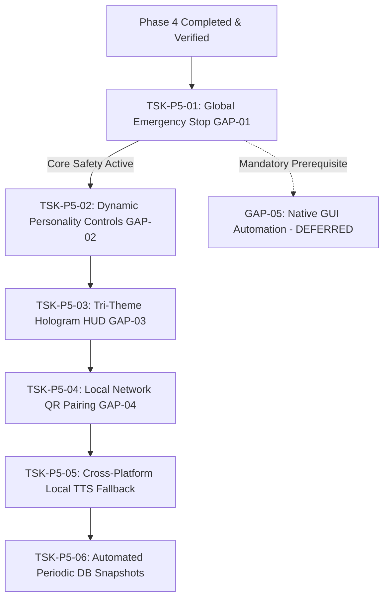

# ULTRON — FEATURE IMPLEMENTATION BACKLOG & PRIORITIZATION
**Task Reference:** `TSK-P4-05`  
**Document Status:** Approved Architecture Deliverable  
**Date of Completion:** October 12, 2026  
**Document Location:** `docs/research/ultron-feature-implementation-backlog.md`  
**Governing Phase:** Phase 4.5 — Finalize Feature Implementation Backlog (Handoff to Phase 5)  
**Prerequisites:** 
- `TSK-P4-01`: [docs/research/stonic-ai-public-capability-inventory.md](file:///d:/Ultron/docs/research/stonic-ai-public-capability-inventory.md)
- `TSK-P4-02`: [docs/research/stonic-ai-to-ultron-feature-gap-analysis.md](file:///d:/Ultron/docs/research/stonic-ai-to-ultron-feature-gap-analysis.md)
- `TSK-P4-03`: [docs/research/feature-feasibility-architecture-assessment.md](file:///d:/Ultron/docs/research/feature-feasibility-architecture-assessment.md)
- `TSK-P4-04`: Automated CI Secret Scanning Implementation ([.github/workflows/secret-scan.yml](file:///d:/Ultron/.github/workflows/secret-scan.yml)) & Baseline Audit ([docs/research/gitleaks-baseline-finding-audit-note.md](file:///d:/Ultron/docs/research/gitleaks-baseline-finding-audit-note.md))

---

## 1. EXECUTIVE SUMMARY & BACKLOG GOVERNANCE

### 1.1 Purpose & Scope
This backlog establishes the prioritized, evidence-based roadmap for Phase 5 implementation of Ultron, a free, autonomous Windows desktop AI assistant. Following the exhaustive capability inventory in `TSK-P4-01`, code-anchored gap analysis in `TSK-P4-02`, architectural impact assessment in `TSK-P4-03`, and Gitleaks CI secret scanning integration in `TSK-P4-04`, this document translates research findings into actionable engineering specifications.

Every candidate capability is evaluated directly against Ultron's verified codebase:
- **Backend Orchestration:** Python 3.12, FastAPI 0.110+, SQLite (WAL mode, FTS5), `openjarvis.server`, `openjarvis.tools`, `openjarvis.agents`.
- **Desktop Host:** Tauri v2 (`@tauri-apps/api` 2.12.0) with Rust runtime (`frontend/src-tauri/src/lib.rs`).
- **Desktop Frontend:** React 19, TypeScript 5.8, TailwindCSS 4, Base UI, Zustand (`frontend/src/`).
- **Interactive Hologram:** WebGL Three.js audio-reactive HUD (`src/openjarvis/server/static/index.html`).
- **Security Core:** PBKDF2-HMAC-SHA256 (600,000 iterations), RBAC capabilities, Subprocess sandbox (`src/openjarvis/security/`).

### 1.2 Core Architectural Principles & Governance Rules
1. **Safety Precedes Feature Expansion:** An assistant capable of shell command execution, browser automation, and multi-agent loops must possess an infallible, instantaneous interrupt mechanism before adding further autonomous capabilities.
2. **Local-First Sovereignty & Zero Exfiltration:** All core functions must operate 100% on the local machine or home local network. Ultron rejects central cloud relays, mandatory telemetry, closed remote servers, and commercial subscription paywalls.
3. **No Phantom Implementations or Duplicate Engines:** Every feature must reuse existing codebase abstractions (such as `subprocess_sandbox.py` process group management and Three.js shader uniforms) rather than importing redundant dependencies or introducing competing rendering pipelines.
4. **Transparent Cost Model:** Application licensing is strictly 100% free under Apache-2.0. Inference costs are separated into local hardware execution (100% free via Ollama) and operator-provided API keys (direct billing with model providers via BYOK with zero platform markups).
5. **CI Secret Scanning Governance:** Automated Gitleaks secret scanning is verified in `.github/workflows/secret-scan.yml` pinned to standalone CLI v8.30.1. Because GitHub branch protection ruleset enforcement requires a GitHub Team organization tier for private repositories, Gitleaks operates as a verified operational pre-merge check rather than an automated GitHub-enforced branch rule.

---

## 2. MULTI-FACTOR EVALUATION & PRIORITIZATION FRAMEWORK

Each candidate capability is evaluated across five weighted engineering dimensions:
- **Safety & Failure Containment (30%):** Does the feature prevent harm, contain runaway loops, or protect user data integrity?
- **User Value & Daily Utility (25%):** How significantly does this feature improve daily user productivity, voice responsiveness, or experience?
- **Architectural Dependency Decoupling (20%):** Can the feature be cleanly built upon existing codebase modules without unblocking complex external systems?
- **Implementation Complexity (15%):** What is the engineering effort, state machine complexity, and risk of regressions?
- **Maintenance & Support Burden (10%):** What is the ongoing cost of testing, platform divergence, and bug triage?

### 2.1 Comparative Prioritization Matrix

| Evaluation Dimension | Rank 1: Global Emergency Stop | Rank 2: Personality Controls | Rank 3: Hologram Themes | Rank 4: Local QR Pairing | Rank 5: Native GUI Automation |
| :--- | :---: | :---: | :---: | :---: | :---: |
| **Feature Identifier** | `GAP-01` | `GAP-02` | `GAP-03` | `GAP-04` | `GAP-05` |
| **Safety & Containment (30%)** | 10 / 10 | 8 / 10 | 6 / 10 | 7 / 10 | 1 / 10 (High Risk) |
| **User Value & Utility (25%)** | 10 / 10 | 9 / 10 | 7 / 10 | 8 / 10 | 4 / 10 (Fragile) |
| **Architecture Decoupling (20%)** | 9 / 10 | 10 / 10 | 10 / 10 | 7 / 10 | 2 / 10 (Heavy Coupling) |
| **Implementation Complexity (15%)**| Medium (7/10) | Small (9/10) | Small (9/10) | Medium (6/10) | Very High (2/10) |
| **Low Maintenance Burden (10%)** | 8 / 10 | 10 / 10 | 9 / 10 | 7 / 10 | 1 / 10 (Extreme Drift) |
| **Weighted Score (out of 10)** | **8.95** | **8.90** | **7.95** | **7.15** | **2.05** |
| **Target Phase 5 Priority** | **P1 (Rank 1)** | **P2 (Rank 2)** | **P2 (Rank 3)** | **P3 (Rank 4)** | **DEFERRED (Rank 5)** |
| **Hard Dependencies** | None (Core Prerequisite) | None | None | LAN Bind Setting | **STRICTLY BLOCKED BY GAP-01** |

---

## 3. IN-DEPTH CANDIDATE SPECIFICATIONS & ACCEPTANCE CRITERIA

---

### 3.1 RANK 1 (P1): Global Emergency Stop & End-to-End Cancellation Contract (`GAP-01`)

#### A. Problem Statement & Codebase Context
When an operator issues a directive resulting in an infinite subagent loop, a hanging shell subprocess, a stalled web scraper, or an overly verbose LLM stream, Ultron currently lacks a synchronized, low-latency escape mechanism across all execution tiers.
- In `src/openjarvis/tools/shell_exec.py` (line 179), `subprocess.run(..., shell=True)` executes synchronously without an active abort handle.
- In `src/openjarvis/security/subprocess_sandbox.py` (lines 81–92), Ultron already possesses a verified `kill_process_tree(pid)` function executing `taskkill /F /T /PID <pid>` inside `CREATE_NEW_PROCESS_GROUP`. This mechanism must be unified with `shell_exec.py`.
- In `src/openjarvis/agents/subagents.py` (lines 376–410), `kill(subagent_id)` invokes `future.cancel()`, which cannot abort a worker thread actively blocked in a synchronous socket read or syscall.
- In `frontend/src-tauri/Cargo.toml` (line 16), `tauri-plugin-global-shortcut = "2"` is already compiled in the desktop shell, providing a ready hook for OS-level hotkeys.

#### B. Architectural Contract: 5-Tier Cancellation Pipeline
A true emergency stop requires synchronized propagation across five system layers:
```
[User Input: Ctrl+Alt+Esc / Web Esc / UI Button]
                    │
                    ▼
[Layer 1: Desktop Hotkey & UI Event] ───► Transitions HUD to "CANCELLING..." (Amber Pulse)
                    │
                    ▼
[Layer 2: IPC & REST Transport] ────────► POST /api/execution/cancel {context_id: "..."}
                    │
                    ▼
[Layer 3: Runtime Coordination Store] ──► ActiveExecutionContextStore.cancel(context_id)
                                          (Sets threading.Event & asyncio.Event)
                    │
                    ▼
[Layer 4: Execution Sandbox Teardown]
   ├── Subprocess Tree: taskkill /F /T /PID <pid> via kill_process_tree()
   ├── Browser Automation: Playwright _session.close() / page.close()
   ├── Subagents Loop: Cooperative is_cancelled check before/after tool dispatch
   └── LLM Streaming: Abort underlying HTTP/TCP socket connection
                    │
                    ▼
[Layer 5: Recovery & State Clean-up] ───► Rollback active transactions; 
                                          Status transitions to STANDBY;
                                          Spoken feedback: "Directive aborted cleanly."
```

#### C. Acceptance Criteria & Verification Strategy
- **AC-GES-01 (Desktop Hotkey Registration):** Tauri desktop shell registers global shortcut `Ctrl+Alt+Escape`. Pressing it anywhere in the OS emits an event to the frontend and backend within <50ms.
- **AC-GES-02 (Web HUD Hotkey & UI Button):** `index.html` binds `Escape` key and displays a persistent red/amber `EMERGENCY STOP` pill in the header during `RUNNING` or `THINKING` states.
- **AC-GES-03 (Cancellation Endpoint):** `POST /api/execution/cancel` accepts `context_id` (or defaults to `active`), verifies user authorization, and returns `HTTP 200 {status: "cancelling", context_id: "..."}` in <25ms.
- **AC-GES-04 (Subprocess Tree Termination):** Refactor `shell_exec.py` to spawn long-running jobs using `subprocess.Popen` with `CREATE_NEW_PROCESS_GROUP`. On abort signal, `kill_process_tree(proc.pid)` terminates the parent shell and all spawned child processes within 250ms. Verified on Windows using orphan process inspection.
- **AC-GES-05 (Browser Session Teardown):** Active Playwright navigation or DOM extraction loops immediately invoke `_session.close()` upon cancellation, releasing Chromium file locks and memory.
- **AC-GES-06 (Subagent Loop Abort):** Subagent orchestrator checks cancellation token before dispatching any sub-task. If set, subagent immediately transitions to `status: "stopped"` without executing subsequent tools.
- **AC-GES-07 (LLM Stream Interruption):** Canceling an in-flight Gemini or local Ollama generation severs the HTTP streaming response, halting further token generation and credit consumption immediately.
- **Test Suite:**
  - `tests/server/test_cancellation.py`: Verify token lifecycle, endpoint responses, and concurrency.
  - `tests/tools/test_shell_cancel.py`: Spawn long-running `powershell Start-Sleep 30`, trigger abort, and assert process tree is fully eliminated from Windows process table.
  - `tests/agents/test_subagent_cancel.py`: Verify multi-step agent terminates mid-execution cleanly.

---

### 3.2 RANK 2 (P2): "Soul Circuit" — Dynamic Personality Controls (`GAP-02`)

#### A. Problem Statement & Codebase Context
Ultron's conversational tone is governed by a static prompt template in `src/openjarvis/server/llm_client.py` (`build_system_prompt()`, lines 76–96). While dignified and articulate, operators currently cannot tune conciseness for fast voice interactions or adjust formality and humor to suit their workflow.
- In `src/openjarvis/core/user_preferences.py`, Ultron already manages persistent preferences (`user_preferences.json`, `get_user_address()`, `set_user_address()`) and synchronizes with SQLite `users.db`.
- In `src/openjarvis/security/injection_scanner.py`, input values are scanned for prompt injection vectors.

#### B. Architectural Solution & Data Contract
1. **Preference Schema Extension:** Extend `user_preferences.json` with a validated `personality` sub-schema:
   ```json
   {
     "preferred_address": "Sir",
     "personality": {
       "verbosity": 0.5,
       "formality": 0.8,
       "humor": 0.2
     }
   }
   ```
2. **Mathematical Input Clamping & Security:**
   - Sliders accept only floating-point values strictly clamped to `[0.0, 1.0]`.
   - Floating-point inputs have zero string escape or injection attack surface.
   - Missing or corrupted values safely default to `0.5`.
3. **Prompt Composition Mapping:**
   Update `build_system_prompt()` in `llm_client.py` to translate float ranges into calibrated instructions:
   - *Verbosity (`0.0–1.0`):*
     - `0.0 – 0.3`: "Ultra-concise brevity. Limit conversational replies to 1–2 crisp sentences unless code/technical analysis is requested."
     - `0.4 – 0.7`: "Balanced voice cadence. Provide clear answers with essential context (2–4 sentences)."
     - `0.8 – 1.0`: "Exhaustive analytical depth. Provide thorough explanations, background rationale, and detailed breakdown."
   - *Formality (`0.0–1.0`):*
     - `0.0 – 0.3`: "Relaxed, conversational banter with casual phrasing."
     - `0.4 – 0.7`: "Polite, balanced professional demeanor."
     - `0.8 – 1.0`: "Strict executive formality, flawless decorum, and high protocol."
   - *Humor (`0.0–1.0`):*
     - `0.0 – 0.3`: "Zero humor. Strictly factual, dry, and analytical."
     - `0.4 – 0.7`: "Occasional subtle, dry wit when natural."
     - `0.8 – 1.0`: "High wit, razor-sharp banter, and playful composure."

#### C. Acceptance Criteria & Verification Strategy
- **AC-PC-01 (Schema & Validation):** `user_preferences.py` reads and writes `personality` dictionary. Non-float or out-of-bounds values are clamped to `[0.0, 1.0]` without raising exceptions.
- **AC-PC-02 (API Routes):** `GET /api/user/preferences` returns personality values. `POST /api/user/preferences` updates personality settings and persists them to disk/database.
- **AC-PC-03 (Prompt Injection Immunity):** Verify that arbitrary malicious payloads cannot be injected through the personality API.
- **AC-PC-04 (Prompt Injection & Synthesis):** `build_system_prompt()` includes calibrated personality directives reflecting the user's configured sliders.
- **AC-PC-05 (UI Sliders):** Settings page in desktop React app and Hologram settings drawer display three responsive range inputs with live value indicators.
- **Test Suite:**
  - `tests/core/test_personality_preferences.py`: Test read, write, boundary clamping, and JSON fallback.
  - `tests/server/test_personality_prompt.py`: Test system prompt generation across extreme slider combinations (`[0.0, 0.0, 0.0]` vs `[1.0, 1.0, 1.0]`).

---

### 3.3 RANK 3 (P2): Tri-Theme Accent Selector for 3D Hologram HUD (`GAP-03`)

#### A. Problem Statement & Codebase Context
Ultron's 3D Hologram HUD (`src/openjarvis/server/static/index.html`) is locked to a single cyan/emerald palette. Providing visual customization strengthens user ownership and aesthetic delight without altering the underlying rendering engine.
- In `index.html` (lines 1266–1435), Three.js creates a WebGL scene with a glowing nucleus (`nucleusMat`), electron particles (`electronMaterial`), and concentric orbital rings (`orbitalRings`).
- Materials currently use hardcoded hex values (such as `color: 0x00f3ff`).
- Root CSS tokens define `--accent-cyan: #38bdf8`, `--accent-amber: #f59e0b`, and `--accent-emerald: #10b981`.

#### B. Architectural Solution: Uniform & Token Injection
To eliminate duplicate canvas overhead, theming must be implemented as a unified controller updating Three.js materials and CSS custom properties in place:
1. **Three Curated Themes:**
   - **Theme 1: Cyan Mark I (Classic Ultron):** Primary `0x00f3ff`, Core `#38bdf8`, Dim `rgba(56, 189, 248, 0.18)`.
   - **Theme 2: Crimson Mark II (Iron Man Armor):** Primary `0xff2a4b`, Core `#ef4444`, Dim `rgba(239, 68, 68, 0.18)`.
   - **Theme 3: Emerald Mark III (Tactical Matrix):** Primary `0x00ff88`, Core `#10b981`, Dim `rgba(16, 185, 129, 0.18)`.
2. **Dynamic Live Switching:**
   A JavaScript theme switcher updates:
   - Three.js material colors: `nucleusMat.color.setHex(theme.threeStandby)`, `electronMaterial.color.setHex(theme.threeStandby)`, orbital ring line materials.
   - CSS root variables: `--accent-primary`, `--accent-dim`, `--glass-border-hover`.
3. **Accessibility & Reduced Motion:**
   - All theme accents adhere to WCAG AA contrast standards (minimum 4.5:1 ratio against `#06080e`).
   - Honor `prefers-reduced-motion`: When enabled, orbital particle rotation speed scales down to 0.001 and breathing scale animations are halted.
4. **Persistence:**
   - Stored in browser `localStorage.getItem('ultron-hologram-theme')` with zero server overhead.

#### C. Acceptance Criteria & Verification Strategy
- **AC-TH-01 (Single WebGL Canvas):** Theme transitions execute without reconstructing the WebGL renderer, canvas DOM element, or audio visualizer.
- **AC-TH-02 (Live Palette Application):** Selecting a theme instantly updates Three.js particle colors and UI CSS tokens without reloading the page.
- **AC-TH-03 (Persistent Selection):** Selected theme persists across page reloads and browser sessions via `localStorage`.
- **AC-TH-04 (WCAG Contrast):** Contrast ratios of text against dark backgrounds exceed 4.5:1 across all three themes.
- **AC-TH-05 (Zero Asset Duplication):** Theme switcher uses pure procedural mathematical geometries; zero proprietary Stonic textures or external assets are included.
- **Test Suite:**
  - Automated HTML/JS smoke test verifying theme switching functions execute without console errors.
  - Contrast audit using Chrome DevTools Lighthouse / a11y testing.

---

### 3.4 RANK 4 (P3): Local Network QR Pairing Wizard for Mobile Companion (`GAP-04`)

#### A. Problem Statement & Codebase Context
Ultron's standalone PWA manifest (`src/openjarvis/server/static/manifest.webmanifest`) and `/hologram` interface can run on mobile browsers. However, pairing a smartphone currently requires manually finding the host's LAN IP address, typing it into a mobile browser, and manually copying credentials.
- Contrast with Stonic AI: Stonic AI routes mobile traffic through external cloud servers (`stonicai.com`), creating an external cloud dependency, exfiltrating desktop control streams, and charging recurring subscriptions.
- In `src/openjarvis/server/auth_middleware.py`, Ultron already enforces strict session tokens and role-based permissions (`Role.ADMIN`, `Role.USER`).
- Precedent in `src/openjarvis/channels/whatsapp_baileys_bridge/`: Precedent exists for QR-code-based cryptographic setup.

#### B. Architectural Solution: Local-First Zero-Trust Handshake
```
[Desktop Operator] ────────► Click "Pair Mobile Companion" in Settings
                                    │
                                    ▼
[Desktop Backend]  ────────► 1. Discover local LAN IP (e.g. 192.168.1.150)
                             2. Generate pairing token: secrets.token_urlsafe(32)
                             3. Store pairing token with 120-second TTL
                                    │
                                    ▼
[Desktop Screen]   ────────► Render QR Code encoding URL:
                             http://192.168.1.150:8000/pair?pt=<TOKEN>
                                    │
                                    ▼
[Mobile Phone]     ────────► Camera scans QR; browser opens URL over Local Wi-Fi
                                    │
                                    ▼
[Desktop Backend]  ────────► 1. Validate token & ensure TTL < 120s
                             2. BURN pairing token immediately (Single-Use Replay Guard)
                             3. Issue scoped mobile session token (Role.MOBILE_OPERATOR)
                             4. Register device in PairedDevicesStore
                             5. Redirect mobile browser to /hologram
                                    │
                                    ▼
[Mobile Phone]     ────────► Hologram PWA connects over WebSocket with mobile token;
                             Voice directives & audio visualizer active!
```

#### C. Threat Model & Safeguards
1. **Single-Use Replay Protection:** Pairing tokens are valid for exactly 120 seconds and are permanently burned on first consumption. A photograph of the screen cannot be reused.
2. **Scoped Role Isolation:** Mobile sessions receive `Role.MOBILE_OPERATOR`. This role permits voice input, directive issuance, and HUD monitoring, but is **explicitly denied** destructive admin operations (e.g., executing arbitrary raw shell commands, deleting databases, wiping memory, or changing security settings).
3. **Opt-in LAN Binding:** The FastAPI server binds strictly to `127.0.0.1` by default. It binds to LAN interfaces (`0.0.0.0`) only when the operator explicitly checks "Enable Local Mobile Access" in Settings.
4. **1-Click Revocation:** The desktop Settings panel lists all active paired mobile devices with IP, user-agent, and paired timestamp, featuring a prominent "Revoke All Mobile Sessions" button that purges active session hashes instantly.

#### D. Acceptance Criteria & Verification Strategy
- **AC-QR-01 (Token Lifecycle):** Pairing tokens generated via `secrets.token_urlsafe(32)` expire after 120 seconds and are immediately invalidated upon first use.
- **AC-QR-02 (Local QR Display):** Desktop UI renders a high-contrast QR code encoding the local LAN IP and token without calling external QR generation APIs.
- **AC-QR-03 (Scoped Role Enforcement):** Requests using mobile companion tokens cannot access administrative or destructive endpoints (`/api/auth/users`, raw shell execution tools).
- **AC-QR-04 (Opt-In Network Exposure):** System remains bound to loopback until mobile access is explicitly enabled by the operator.
- **AC-QR-05 (Instant Revocation):** Clicking "Revoke Mobile Access" invalidates all active companion sessions within <100ms.
- **Test Suite:**
  - `tests/server/test_qr_pairing.py`: Test token generation, single-use burn, expiration after 120s, and replay rejection.
  - `tests/security/test_mobile_role_rbac.py`: Verify `Role.MOBILE_OPERATOR` is blocked from admin routes and permitted on directive routes.

---

### 3.5 RANK 5 (DEFERRED): Native Desktop GUI Automation (`GAP-05`)

#### A. Comprehensive Technical Justification for Deferral
Synthetic mouse and keyboard automation (taking desktop screenshots, passing them to a vision model, and synthetically clicking native Windows desktop applications) is **formally deferred**.

The technical, reliability, and safety analysis reveals critical failure modes:
1. **Multi-Monitor & DPI Scaling Drift:** Windows displays commonly operate at non-integer DPI scaling (125%, 150%, 175%, 200%). Visual language model (VLM) coordinate predictions computed on downscaled screenshots drift by 15–50 pixels on high-DPI displays, causing clicks to hit empty space or wrong UI elements.
2. **Windows UIPI Elevation Barriers:** Windows User Interface Privilege Isolation (UIPI) strictly forbids non-elevated processes from sending synthetic mouse or keyboard events to elevated (Administrator) windows (such as Task Manager, elevated terminals, or UAC prompts). The automation silently fails with zero feedback.
3. **Input Focus Stealing & Operator Desynchronization:** Synthetic clicking requires bringing target windows to the foreground. If the operator touches their physical mouse or types on their keyboard while the AI is moving the cursor, input events interleave unpredictably, resulting in corrupted text entry or erratic clicks.
4. **Destructive Misclick Risks:** A 30-pixel coordinate error can click "Delete", "Format Drive", "Drop Database", or "Send Message" instead of intended controls.
5. **Prohibitive Latency and Inference Costs:** Each synthetic desktop action requires capturing a 1080p/4K display (~2–4 MB), encoding vision tokens (~1,600 tokens), and awaiting VLM inference (2–6 seconds). A simple 10-step desktop task consumes ~20,000 tokens and 45+ seconds of latency.
6. **Existing Ultron Superiority in Browser & Headless Control:** Ultron already provides reliable, semantic browser automation via Playwright (`src/openjarvis/tools/browser.py`, `browser_axtree.py`) using DOM accessibility trees, and headless background messaging (`whatsapp_baileys.py`). These methods are 100x faster, zero-DPI-dependent, and 100% resilient.

#### B. The Hard Architectural Blocker: Why Emergency Stop Must Precede GUI Automation
> [!CRITICAL]
> **SAFETY PRINCIPLE: GUI Automation Must NOT Precede Global Emergency Stop**  
> Under no circumstances may native desktop mouse/keyboard automation be introduced before Rank 1 (`GAP-01`: Global Emergency Stop) is fully implemented, verified, and battle-tested.  
> 
> If an autonomous agent begins executing synthetic mouse clicks in a loop and encounters an unexpected dialog or error state, it will repeatedly click and steal mouse focus. If the system lacks an infallible, low-level OS hotkey (`Ctrl+Alt+Escape`) that instantly kills the process tree and halts input synthesis, **the operator is physically locked out of their own mouse and keyboard**. They cannot click "Stop" in the UI, cannot switch windows, and may be forced to hard-reset their physical PC to prevent data destruction.
> 
> Therefore, reliable end-to-end cancellation is a mandatory prerequisite before synthetic input automation can ever be considered.

#### C. Pre-conditions for Future Re-evaluation
Native GUI automation may only be revisited in a future phase if:
1. Rank 1 (Global Emergency Stop) is fully operational with proven OS process termination.
2. A formal UI Automation (UIA) accessibility tree driver (similar to Microsoft UI Automation) is developed to target elements semantically by control ID rather than raw pixel coordinates.
3. A strict human-in-the-loop confirmation modal is required prior to any native desktop click action.

---

## 4. PHASE 5 IMPLEMENTATION SEQUENCING & ROADMAP

The five candidates and existing Phase 5 commitments are organized into an ordered, single-task implementation sequence:



### 4.1 Granular Phase 5 Task Sequence

| Phase 5 Task ID | Capability / Feature | Priority | Estimated Complexity | Prerequisites | Deliverables & Verification |
| :--- | :--- | :---: | :---: | :--- | :--- |
| **TSK-P5-01** | **Global Emergency Stop (`GAP-01`)** | **P1** | Medium | Phase 4 Approval | Tauri hotkey (`Ctrl+Alt+Esc`), web HUD `Esc`, `kill_process_tree` in `shell_exec.py`, Playwright abort, streaming token abort. |
| **TSK-P5-02** | **Dynamic Personality Controls (`GAP-02`)** | **P2** | Small | TSK-P5-01 | Bounded sliders in `user_preferences.py`, injection-safe float validation, prompt composition in `llm_client.py`, UI sliders. |
| **TSK-P5-03** | **Tri-Theme Hologram HUD (`GAP-03`)** | **P2** | Small | TSK-P5-01 | Three.js material & CSS token injection in `index.html` (Cyan, Crimson, Emerald), WCAG AA contrast, localStorage persistence. |
| **TSK-P5-04** | **Local Network QR Pairing (`GAP-04`)** | **P3** | Medium | TSK-P5-01 | 120s TTL single-use pairing token, canvas QR render, scoped `Role.MOBILE_OPERATOR` in `auth_middleware.py`, 1-click revoke. |
| **TSK-P5-05** | **Cross-Platform Local TTS Fallback** | **P2** | Small | TSK-P5-01 | Extend `tts_engine.py` with macOS `say` and Linux `espeak-ng` support to complement existing Windows SAPI/PowerShell TTS. |
| **TSK-P5-06** | **Automated Periodic DB Snapshots** | **P2** | Small | TSK-P5-01 | Background hot backup task (`sqlite3.backup`) for `users.db` and `memory.db` with rotation in `src/openjarvis/scheduler/`. |

---

## 5. SUMMARY OF DECISIONS & GOVERNANCE RECORD

1. **Backlog Prioritization Approved:**
   - **Rank 1 (`GAP-01`):** Global Emergency Stop — Top priority, foundational safety guarantee for all execution.
   - **Rank 2 (`GAP-02`):** Personality Controls — High daily conversational utility, low complexity, zero security risk.
   - **Rank 3 (`GAP-03`):** Hologram Themes — High aesthetic polish, single WebGL canvas, zero asset duplication.
   - **Rank 4 (`GAP-04`):** Local QR Pairing — Effortless mobile onboarding, 100% local, zero cloud exfiltration.
   - **Rank 5 (`GAP-05`):** Native Desktop GUI Automation — Formally deferred due to technical fragility and safety hazards.
2. **Safety Barrier Enforced:** Native GUI automation is formally blocked until Rank 1 emergency stop is implemented and proven.
3. **Zero Application Changes in TSK-P4-05:** In accordance with scope discipline, this task creates only research and governance documentation.
4. **CI Secret Scanning Position Confirmed:** Automated Gitleaks secret scanning is verified in `.github/workflows/secret-scan.yml` with manual verification before merge to `main`.
